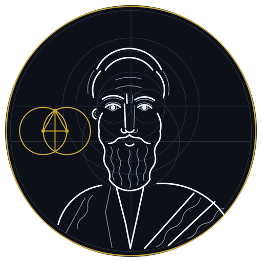
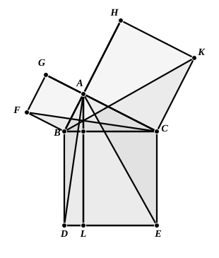

<a href="https://geometor.github.io/euclid/"></a>

# GEOMETOR • euclid

**Visit the Online Archive:** https://geometor.github.io/euclid/

<p align="center">
  <a href="https://geometor.github.io/euclid/"></a>
</p>

**Euclid of Alexandria • Elements, Data • semantic digital archive**

## Mission

`geometor/euclid` is part of the interconnected [GEOMETOR](https://geometor.com) semantic digital archive. It preserves and liberates the foundational treatises of Euclid of Alexandria—Sir Thomas L. Heath's monumental three-volume critical edition of the *Elements* and the bilingual critical edition of the *Data*—transforming 1,416 archival folios and over 800 diagrams into addressable semantic units, synchronized reading tracks, calibrated theme-adaptive vector graphics, and primary-source folio provenance across the GEOMETOR corpus.

## Books in This Archive

- [The Thirteen Books of Euclid's Elements](https://geometor.github.io/euclid/heath/) — Translated from the Text of Heiberg with Introduction and Commentary by Sir Thomas L. Heath (1926), featuring synchronized Proposition and Commentary tracks, interactive geometric indications, and justification links.
- [Euclid's Data](https://geometor.github.io/euclid/data/) — Δεδομένα bilingual critical edition (Menge 1896 & Simson 1806) capturing Euclid's companion treatise on geometric analysis and determinacy.

## Repository Contents

- `docsrc/` — De-paginated two-track Book Codex, apparatus registries, and Sphinx docs compiled by [PHOTON publish](https://github.com/photon-platform/publish).
- `resources/` — 1,416 high-resolution folio scans, transcription files, editorial notes, and calibrated SVGs for Heath and Data.
- `src/geometor/euclid/` — Edition compilation pipelines, SVG recalibration utilities, and folio ingestion tools.

## Local Build & Verification

```bash
publish build
uv run --no-sync pytest
```
## Part of the GEOMETOR Knowledge Archive

Explore all **74 Book Codices** and **11 Mathematical Catalogs** at https://geometor.com/books/.
