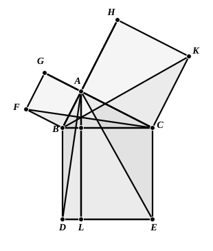

GEOMETOR • euclid
=================

**Visit the Online Archive:** https://geometor.github.io/euclid/

**Euclid of Alexandria • Elements, Data • semantic digital archive**

Mission
-------

``geometor/euclid`` is part of the interconnected `GEOMETOR <https://geometor.com>`_ semantic digital archive. It preserves and liberates the foundational treatises of Euclid of Alexandria—Sir Thomas L. Heath's monumental three-volume critical edition of the *Elements* and the bilingual critical edition of the *Data*—transforming 1,416 archival folios and over 800 diagrams into addressable semantic units, synchronized reading tracks, calibrated theme-adaptive vector graphics, and primary-source folio provenance across the GEOMETOR corpus.

Books in This Archive
---------------------

- `The Thirteen Books of Euclid's Elements <https://geometor.github.io/euclid/heath/>`_ — Translated from the Text of Heiberg with Introduction and Commentary by Sir Thomas L. Heath (1926), featuring synchronized Proposition and Commentary tracks, interactive geometric indications, and justification links.
- `Euclid's Data <https://geometor.github.io/euclid/data/>`_ — Δεδομένα bilingual critical edition (Menge 1896 & Simson 1806) capturing Euclid's companion treatise on geometric analysis and determinacy.

Python Package & Modules
------------------------

The ``geometor-euclid`` Python package (``import geometor.euclid``) provides the executable symbolic geometry, construction, and compilation modules powering this archive:

- ``compile_edition.py`` — De-Pagination and Edition Compiler for GEOMETOR Euclid (Heath Edition).
- ``data_codex.py`` — Concordance loader, validator, and functional DAG query helpers for Euclid's *Data*.
- ``folio_review/app.py`` — Flask web application for Euclid Folio Review & Vetting.
- ``folio_review/reviews.py`` — Persistent review and vetting status tracker for Euclid folios.
- ``folio_review/rst_utils.py`` — Custom Docutils RST renderer for Euclid Folio Review.
- ``folio_review/scanner.py`` — Folio discovery, metadata parsing, and statistics aggregation for Euclid.
- ``graph.py`` — Build dependency graphs and inject Graphviz proof chains into composed RST files under docsrc/heath/.
- ``ingest/analysis.py`` — Module for analyzing extracted text to identify propositions.
- ``ingest/cleanup.py`` — Module for image cleanup operations.
- ``ingest/config.py`` — Configuration settings for ingestion processes.
- *Plus 23 additional modules under* ``src/geometor/euclid/``.

See the `API Reference <https://geometor.github.io/euclid/modules/>`_ for full module documentation.

Repository Contents
-------------------

- ``docsrc/`` — De-paginated two-track Book Codex, apparatus registries, and Sphinx docs compiled by `PHOTON publish <https://github.com/photon-platform/publish>`_.
- ``resources/`` — 1,416 high-resolution folio scans, transcription files, editorial notes, and calibrated SVGs for Heath and Data.
- ``src/geometor/euclid/`` — Edition compilation pipelines, SVG recalibration utilities, and folio ingestion tools.

Local Build & Verification
--------------------------

.. code-block:: bash

   publish build
   uv run --no-sync pytest

Part of the GEOMETOR Knowledge Archive
--------------------------------------

Explore all **74 Book Codices** and **11 Mathematical Catalogs** at https://geometor.com/books/.
