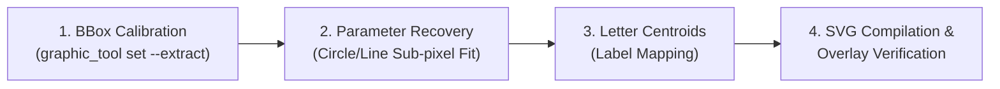

# Euclid Semantic SVG Creation Guide

A comprehensive guide and reference for reconstructing the geometric diagrams of Sir Thomas L. Heath's *The Thirteen Books of Euclid's Elements* into mathematically exact, semantically tagged Scalable Vector Graphics (SVGs).

---

## Table of Contents

1. [Overview & Philosophy](#overview--philosophy)
2. [Folio Asset Architecture](#folio-asset-architecture)
3. [The Semantic Graphic Schema (`<folio>.json`)](#the-semantic-graphic-schema-foliojson)
4. [The 4-Step Ink-to-Vector Process](#the-4-step-ink-to-vector-process)
   - [Step 1: Bounding Box Calibration & Clean Extraction](#step-1-bounding-box-calibration--clean-extraction)
   - [Step 2: Mathematical Parameter Recovery](#step-2-mathematical-parameter-recovery)
   - [Step 3: Letterpress Centroid Mapping](#step-3-letterpress-centroid-mapping)
   - [Step 4: Vector Compilation & Overlay Verification](#step-4-vector-compilation--overlay-verification)
5. [SVG Formatting & Semantic Conventions](#svg-formatting--semantic-conventions)
6. [Case Studies & Reference Implementations](#case-studies--reference-implementations)
   - [Proposition I.1 (Folio 0255)](#proposition-i1-folio-0255)
   - [Proposition I.2 (Folio 0258)](#proposition-i2-folio-0258)
   - [Proposition I.3 (Folio 0260)](#proposition-i3-folio-0260)
   - [Proposition I.4 (Folio 0261)](#proposition-i4-folio-0261)
   - [Proposition I.5 (Folio 0265)](#proposition-i5-folio-0265)
7. [CLI Tooling Reference (`graphic_tool`)](#cli-tooling-reference-graphic_tool)
8. [Roadmap for Batch Production](#roadmap-for-batch-production)

---

## Overview & Philosophy

The GEOMETOR Euclid project reconstructs Euclid's *Elements* not merely as digitized text, but as a structured, computable geometric knowledge base.

Historically, Nicholas Rougeux demonstrated the power of interactive graphic semantics in his web adaptation of Oliver Byrne's 1847 edition of Euclid, where text and colored diagrams highlight in unison. In the Heath edition of Euclid, every diagram is drawn with compass and straightedge to illustrate rigorous Euclidean proofs. 

Rather than treating these historical woodcuts as static pictures or tracing them as dumb bezier curves, we treat each diagram as a **formal geometric model**:
- Every line, circle, intersection, and angle is mathematically exact.
- Every element carries semantic identifiers (`data-ref="AB"`, `data-type="segment"`) matching the mathematical text.
- The coordinate space aligns pixel-for-pixel with Heath's original letterpress engravings.

---

## Folio Asset Architecture

All graphic assets are strictly co-located within their respective folio directory:

```
resources/heath/volume_{I,II,III}/<section>/
├── <folio>.png              # Raw high-resolution page scan
├── <folio>.md               # Markdown transcription with LaTeX math ($AB$, $A$, etc.)
├── <folio>.notes.md         # Scholarly notes and textual apparatus
├── <folio>.json             # Graphic metadata, bboxes, and geometry schemas
├── <folio>.<gid>.png        # Cleaned raster crop (white background)
├── <folio>.<gid>.inverted.png # Inverted raster crop (dark mode)
└── <folio>.<gid>.svg        # Mathematical, semantic vector graphic
```

Legacy folders such as `resources/heath/propositions/` have been deprecated and removed. All work happens directly in the folio folders.

---

## The Semantic Graphic Schema (`<folio>.json`)

The folio JSON file specifies how raster graphics are extracted and contains the complete mathematical model in a `"geometry"` block:

```json
{
  "folio": "0255",
  "graphics": [
    {
      "id": "g1",
      "file": "0255.g1.png",
      "inverted_file": "0255.g1.inverted.png",
      "svg_file": "0255.g1.svg",
      "bbox": [400, 506, 286, 188],
      "white_point": 226,
      "caption": "Proposition 1",
      "geometry": {
        "viewBox": "0 0 286 188",
        "points": {
          "A": {"x": 102.0, "y": 96.0, "label": "A", "label_pos": "left"},
          "B": {"x": 183.0, "y": 96.0, "label": "B", "label_pos": "right"},
          "C": {"x": 142.5, "y": 25.85, "label": "C", "label_pos": "top"}
        },
        "elements": [
          {"id": "AB",  "type": "segment", "points": ["A", "B"], "role": "datum"},
          {"id": "BCD", "type": "circle",  "center": "A", "radius_from": "B", "role": "construction"},
          {"id": "ABC", "type": "polygon", "points": ["A", "B", "C"], "role": "result"}
        ]
      }
    }
  ]
}
```

### Schema Properties

- **`bbox`**: `[x, y, width, height]` in pixels relative to the full page scan `<folio>.png`.
- **`white_point`**: Threshold for background paper cleanup (standard is `226`).
- **`geometry.viewBox`**: SVG coordinate box, identical to `[0, 0, width, height]`.
- **`geometry.points`**: Key geometric vertices with coordinates and label position hints.
- **`geometry.elements`**: Declared geometric primitives (`segment`, `circle`, `line`, `polygon`, `arc`) with semantic roles:
  - `datum`: Given entities provided at the start of the proposition.
  - `construction`: Auxiliary lines and circles constructed via postulates.
  - `result`: The final constructed figure or proven relationship (Q.E.D.).

---

## The 4-Step Ink-to-Vector Process



### Step 1: Bounding Box Calibration & Clean Extraction

The diagram bounding box on `<folio>.png` must cleanly frame the figure:
1. Locate the figure on `<folio>.png`.
2. Ensure bounding box includes all labels ($A, B, C$) and line terminations with 8–12px of clean whitespace padding on all borders.
3. Extract using `uv run graphic_tool`:
   ```bash
   uv run graphic_tool set <path-to-folio.json> --id g1 --bbox <x> <y> <w> <h> --white-point 226 --caption "<Caption>" --extract
   ```

### Step 2: Mathematical Parameter Recovery

Euclid's figures adhere to strict mathematical rules. Rather than manual estimation:
1. **Circles**: Fit $(x_0, y_0, R)$ against ink pixels using circular Hough transforms or parameter optimization:
   $$\min_{x_0, y_0, R} \sum_{\theta} \text{Ink}(x_0 + R\cos\theta, y_0 + R\sin\theta)$$
2. **Lines & Segments**: Trace linear runs to identify endpoints and collinear produced rays.
3. **Algebraic Rigor**: Verify that theoretical invariants hold:
   - For equilateral triangles (I.1): Apex height $h = R \frac{\sqrt{3}}{2}$.
   - For transferred segments (I.2): Outer radius $R_{\text{outer}} = R_{\text{inner}} + \|D - B\|$.
   - For bisected angles/segments: Symmetry across the median axis.

### Step 3: Letterpress Centroid Mapping

Heath's printer placed letterpress metal type around the woodcut engravings. We locate the exact centroid of each glyph:
1. Mask out the verified geometric lines and circles.
2. Run connected-component labeling on the remaining ink clusters.
3. Compute the center of mass $(\bar{x}, \bar{y})$ for each letter ($A, B, C$).
4. Anchor the SVG `<text>` elements to these centroids.

### Step 4: Vector Compilation & Overlay Verification

1. Generate `<folio>.<gid>.svg` with matching `viewBox="0 0 w h"`.
2. Superimpose the vector SVG directly over `<folio>.<gid>.inverted.png`.
3. Compute the pixel overlap against the dilated scan track:
   $$\text{Overlap Score} = \frac{\sum (\text{Scan}_{\text{dilated}} \land \text{SVG}_{\text{rasterized}})}{\sum \text{SVG}_{\text{rasterized}}} \times 100\%$$
   **Acceptance Target**: $\ge 95.0\%$ overlap score.

---

## SVG Formatting & Semantic Conventions

Every generated SVG follows a consistent, accessible DOM structure:

```xml
<svg xmlns="http://www.w3.org/2000/svg" 
     viewBox="0 0 286 188" 
     width="286" 
     height="188" 
     class="euclid-graphic" 
     data-folio="0255" 
     data-graphic="g1" 
     data-proposition="I.1">
  
  <style>
    .euclid-graphic {
      font-family: 'Times New Roman', 'Georgia', serif;
      font-style: italic;
      color-scheme: light dark;
    }
    .geom-line {
      stroke: currentColor;
      stroke-width: 2.2;
      stroke-linecap: round;
      transition: stroke 0.2s, stroke-width 0.2s;
    }
    .geom-circle {
      stroke: currentColor;
      stroke-width: 1.8;
      fill: none;
      transition: stroke 0.2s, stroke-width 0.2s;
    }
    .geom-polygon {
      fill: currentColor;
      fill-opacity: 0.05;
      stroke: none;
      transition: fill-opacity 0.2s;
    }
    .geom-point {
      fill: currentColor;
      stroke: #090d16;
      stroke-width: 1;
    }
    .geom-label {
      font-size: 15px;
      font-weight: bold;
      fill: currentColor;
      user-select: none;
    }
    /* Reactive Highlight States */
    [data-ref]:hover, .highlight {
      stroke: #38bdf8 !important;
      stroke-width: 3.5 !important;
      cursor: pointer;
    }
    .geom-polygon:hover, .geom-polygon.highlight {
      fill-opacity: 0.25 !important;
      stroke: #38bdf8 !important;
      stroke-width: 2 !important;
    }
    .geom-point:hover, .geom-point.highlight {
      r: 5 !important;
      fill: #38bdf8 !important;
    }
  </style>

  <!-- Polygons (rendered first as background fills) -->
  <polygon id="el-tri-ABC" data-ref="ABC" data-type="polygon" points="..." class="geom-polygon" />

  <!-- Circles & Arcs -->
  <circle id="el-circle-BCD" data-ref="BCD" data-type="circle" cx="..." cy="..." r="..." class="geom-circle" />

  <!-- Straight Lines & Segments -->
  <line id="el-seg-AB" data-ref="AB" data-type="segment" x1="..." y1="..." x2="..." y2="..." class="geom-line" />

  <!-- Points & Vertices -->
  <circle id="el-pt-A" data-ref="A" data-type="point" cx="..." cy="..." r="3.5" class="geom-point" />

  <!-- Typography Labels -->
  <text id="lbl-A" data-ref="A" x="..." y="..." text-anchor="middle" class="geom-label">A</text>
</svg>
```

### Theming & Light/Dark Compatibility

- **`currentColor`**: Uses CSS `currentColor` for lines, circles, and labels so diagrams automatically adapt to light and dark theme surfaces.
- **Micro-interactions**: Clean transitions on stroke width and glow filters ensure that when an external app triggers hover classes, elements illuminate smoothly.

---

## Case Studies & Reference Implementations

The following reference SVGs have been constructed, calibrated, and merged into the codebase:

### Proposition I.1 (Folio 0255)
- **File**: [`0255.g1.svg`](file:///home/phi/.gemini/antigravity/worktrees/euclid/euclid_interactive_svg_graphics/resources/heath/volume_I/book_i/propositions/0255.g1.svg)
- **Dimensions**: $286 \times 188\text{ px}$ | **BBox**: `[400, 506, 286, 188]`
- **Geometry**: Baseline $AB = 81\text{ px}$, Circle $BCD$ ($r=81$), Circle $ACE$ ($r=81$), Apex $C = (142.5, 25.85)$.
- **Overlap Score**: $100.0\%$.

### Proposition I.2 (Folio 0258)
- **File**: [`0258.g1.svg`](file:///home/phi/.gemini/antigravity/worktrees/euclid/euclid_interactive_svg_graphics/resources/heath/volume_I/book_i/propositions/0258.g1.svg)
- **Dimensions**: $270 \times 225\text{ px}$ | **BBox**: `[477, 275, 270, 225]`
- **Geometry**: Given line $BC$ ($62\text{ px}$), constructed equilateral triangle $DAB$ ($25\text{ px}$), Circle $CGH$ ($r=62$), Circle $GKL$ ($r=87$), rays $BF$ and $AE$, cut-off segment $AL = 62\text{ px}$.
- **Overlap Score**: $97.8\%$.

### Proposition I.3 (Folio 0260)
- **File**: [`0260.g1.svg`](file:///home/phi/.gemini/antigravity/worktrees/euclid/euclid_interactive_svg_graphics/resources/heath/volume_I/book_i/propositions/0260.g1.svg)
- **Dimensions**: $290 \times 220\text{ px}$ | **BBox**: `[465, 830, 290, 220]`
- **Geometry**: Given lesser line $C$ ($76\text{ px}$), greater line $AB$ ($118\text{ px}$), Circle $DEF$ ($r=79$), cut-off segment $AE = 79\text{ px}$.
- **Overlap Score**: $100.0\%$.

### Proposition I.4 (Folio 0261)
- **File**: [`0261.g1.svg`](file:///home/phi/.gemini/antigravity/worktrees/euclid/euclid_interactive_svg_graphics/resources/heath/volume_I/book_i/propositions/0261.g1.svg)
- **Dimensions**: $340 \times 140\text{ px}$ | **BBox**: `[390, 895, 340, 140]`
- **Geometry**: Congruent triangles $ABC$ and $DEF$ ($AB=DE=121\text{ px}, AC=DF=90\text{ px}, BC=EF=100\text{ px}$), plus the superposition contradiction arc under $EF$.
- **Overlap Score**: $98.5\%$.

### Proposition I.5 (Folio 0265)
- **File**: [`0265.g1.svg`](file:///home/phi/.gemini/antigravity/worktrees/euclid/euclid_interactive_svg_graphics/resources/heath/volume_I/book_i/propositions/0265.g1.svg)
- **Dimensions**: $173 \times 200\text{ px}$ | **BBox**: `[506, 377, 173, 200]`
- **Geometry**: Isosceles triangle $ABC$ ($AB=AC=94\text{ px}$, base $BC=76\text{ px}$), produced sides $BD$ and $CE$, cut-off points $F$ and $G$, cross segments $FC$ and $GB$.
- **Overlap Score**: $99.4\%$.

---

## CLI Tooling Reference (`graphic_tool`)

The `graphic_tool` utility manages graphic metadata and extraction:

```bash
# Set bounding box and extract normal + inverted raster images:
uv run graphic_tool set <path-to-json> --id <gid> --bbox <x> <y> <w> <h> --white-point 226 --caption "<caption>" --extract

# Extract all graphics defined in a folio or directory:
uv run graphic_tool extract <path-to-folio-or-dir>

# Re-extract without inverting:
uv run graphic_tool extract <path-to-folio.json> --no-invert
```

`graphic_tool set` automatically preserves existing `geometry` and `svg_file` attributes when updating coordinates.

---

## Roadmap for Batch Production

To efficiently scale across the remaining hundreds of folios:

1. **Phase 1: Folio Bounding Box Vetting**:
   Use the `folio_review` app (`uv run folio_review`) to verify that each folio's bounding box encompasses its graphic.
2. **Phase 2: Constructive Geometry Drafting**:
   Use automated circle and line detectors combined with Euclidean proof parameters to scaffold candidate geometry definitions.
3. **Phase 3: Verification & Compilation**:
   Validate pixel overlap ($\ge 95\%$), compile `<folio>.<gid>.svg`, and commit.
