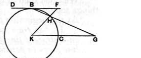

# INTRODUCTION.

## CHAPTER II.
### EUCLID'S OTHER WORKS.

IN giving a list of the Euclidean treatises other than the *Elements*, I shall be brief: for fuller accounts of them, or speculations with regard to them, reference should be made to the standard histories of mathematics[^1].

I will take first the works which are mentioned by Greek authors.

#### 1. The *Pseudaria*.

I mention this first because Proclus refers to it in the general remarks in praise of the *Elements* which he gives immediately after the mention of Euclid in his summary. He says[^2]: "But, inasmuch as many things, while appearing to rest on truth and to follow from scientific principles, really tend to lead one astray from the principles and deceive the more superficial minds, he has handed down methods for the discriminative understanding of these things as well, by the use of which methods we shall be able to give beginners in this study practice in the discovery of paralogisms, and to avoid being misled. This treatise, by which he puts this machinery in our hands, he entitled (the book) of *Pseudaria*, enumerating in order their various kinds, exercising our intelligence in each case by theorems of all sorts, setting the true side by side with the false, and combining the refutation of error with practical illustration. This book then is by way of cathartic and exercise, while the *Elements* contain the irrefragable and complete guide to the actual scientific investigation of the subjects of geometry."

The book is considered to be irreparably lost. We may conclude however from the connexion of it with the *Elements* and the reference to its usefulness for beginners that it did not go outside the domain of elementary geometry[^3].

#### 2. The *Data*.

The *Data* (δεδομένα) are included by Pappus in the *Treasury of Analysis* (τόπος ἀναλυόμενος), and he describes their contents[^4]. They are still concerned with elementary geometry, though forming part of the introduction to higher analysis. Their form is that of propositions proving that, if certain things in a figure are *given* (in magnitude, in species, etc.), something else is *given*. The subject-matter is much the same as that of the planimetrical books of the *Elements*, to which the *Data* are often supplementary. We shall see this later when we come to compare the propositions in the *Elements* which give us the means of solving the general quadratic equation with the corresponding propositions of the *Data* which give the solution. The *Data* may in fact be regarded as elementary exercises in analysis.

It is not necessary to go more closely into the contents, as we have the full Greek text and the commentary by Marinus newly edited by Menge and therefore easily accessible[^5].

#### 3. The book *On divisions (of figures)*.

This work (περὶ διαιρέσεων βιβλίον) is mentioned by Proclus[^6]. In one place he is speaking of the conception or definition (λόγος) of *figure*, and of the divisibility of a figure into others differing from it in kind; and he adds: "For the circle is divisible into parts unlike in definition or notion (ἀνόμοια τῷ λόγῳ), and so is each of the rectilinear figures; this is in fact the business of the writer of the Elements in his *Divisions*, where he divides given figures, in one case into like figures, and in another into unlike[^7]." "Like" and "unlike" here mean, not "similar" and "dissimilar" in the technical sense, but "like" or "unlike *in definition or notion*" (λόγῳ): thus to divide a triangle into triangles would be to divide it into "like" figures, to divide a triangle into a triangle and a quadrilateral would be to divide it into "unlike" figures.

The treatise is lost in Greek but has been discovered in the Arabic. First John Dee discovered a treatise *De divisionibus* by one Muḥammad Bagdadinus[^8] and handed over a copy of it (in Latin) in 1563 to Commandinus, who published it, in Dee's name and his own, in 1570[^9]. Dee did not himself translate the tract from the Arabic; he found it in Latin in a MS. which was then in his own possession but was about 20 years afterwards stolen or destroyed in an attack by a mob on his house at Mortlake[^10]. Dee, in his preface addressed to Commandinus, says nothing of his having translated the book, but only remarks that the very illegible MS. had caused him much trouble and (in a later passage) speaks of "the actual, very ancient, copy from which I wrote out..." (*in ipso unde descripsi vetustissimo exemplari*). The Latin translation of this tract from the Arabic was probably made by Gherard of Cremona (1114–1187), among the list of whose numerous translations a "*liber divisionum*" occurs. The Arabic original cannot have been a direct translation from Euclid, and probably was not even a direct adaptation of it; it contains mistakes and unmathematical expressions, and moreover does not contain the propositions about the division of a circle alluded to by Proclus. Hence it can scarcely have contained more than a fragment of Euclid's work.

But Woepcke found in a MS. at Paris a treatise in Arabic on the division of figures, which he translated and published in 1851[^11]. It is expressly attributed to Euclid in the MS. and corresponds to the description of it by Proclus. Generally speaking, the divisions are divisions into figures of the same kind as the original figures, e.g. of triangles into triangles; but there are also divisions into "unlike" figures, e.g. that of a triangle by a straight line parallel to the base. The missing propositions about the division of a circle are also here: "to divide into two equal parts a given figure bounded by an arc of a circle and two straight lines including a given angle" and "to draw in a given circle two parallel straight lines cutting off a certain part of the circle." Unfortunately the proofs are given of only four propositions (including the two last mentioned) out of 36, because the Arabic translator found them too easy and omitted them. To illustrate the character of the problems dealt with I need only take one more example: "To cut off a certain fraction from a (parallel-) trapezium by a straight line which passes through a given point lying inside or outside the trapezium but so that a straight line can be drawn through it cutting both the parallel sides of the trapezium." The genuineness of the treatise edited by Woepcke is attested by the facts that the four proofs which remain are elegant and depend on propositions in the *Elements*, and that there is a lemma with a true Greek ring: "*to apply to a straight line a rectangle equal to the rectangle contained by AB, AC and deficient by a square*." Moreover the treatise is no fragment, but finishes with the words "end of the treatise," and is a well-ordered and compact whole. Hence we may safely conclude that Woepcke's is not only Euclid's own work but the whole of it. A restoration of the work, with proofs, was attempted by Ofterdinger[^12], who however does not give Woepcke's props. 30, 31, 34, 35, 36. We have now a satisfactory restoration, with ample notes and an introduction, by R. C. Archibald, who used for the purpose Woepcke's text and a section of Leonardo of Pisa's *Practica geometriae* (1220)[^13].

#### 4. The *Porisms*.

It is not possible to give in this place any account of the controversies about the contents and significance of the three lost books of *Porisms*, or of the important attempts by Robert Simson and Chasles to restore the work. These may be said to form a whole literature, references to which will be found most abundantly given by Heiberg and Loria, the former of whom has treated the subject from the philological point of view, most exhaustively, while the latter, founding himself generally on Heiberg, has added useful details, from the mathematical side, relating to the attempted restorations, etc.[^14] It must suffice here to give an extract from the only original source of information about the nature and contents of the *Porisms*, namely Pappus[^15]. In his general preface about the books composing the *Treasury of Analysis* (τόπος ἀναλυόμενος) he says:

> "After the *Tangencies* (of Apollonius) come, in three books, the *Porisms* of Euclid, [in the view of many] a collection most ingeniously devised for the analysis of the more weighty problems, [and] although nature presents an unlimited number of such porisms[^16], [they have added nothing to what was written originally by Euclid, except that some before my time have shown their want of taste by adding to a few (of the propositions) second proofs, each (proposition) admitting of a definite number of demonstrations, as we have shown, and Euclid having given one for each, namely that which is the most lucid. These porisms embody a theory subtle, natural, necessary, and of considerable generality, which is fascinating to those who can see and produce results].
>
> "Now all the varieties of porisms belong, neither to theorems nor problems, but to a species occupying a sort of intermediate position [so that their enunciations can be formed like those of either theorems or problems], the result being that, of the great number of geometers, some regarded them as of the class of theorems, and others of problems, looking only to the form of the proposition. But that the ancients knew better the difference between these three things is clear from the definitions. For they said that a theorem is that which is proposed with a view to the demonstration of the very thing proposed, a problem that which is thrown out with a view to the construction of the very thing proposed, and a porism that which is proposed with a view to the producing of the very thing proposed. [But this definition of the porism was changed by the more recent writers who could not produce everything, but used these elements and proved only the fact that that which is sought really exists, but did not produce it[^17] and were accordingly confuted by the definition and the whole doctrine. They based their definition on an incidental characteristic, thus: A porism is that which falls short of a locus-theorem in respect of its hypothesis[^18]. Of this kind of porisms loci are a species, and they abound in the *Treasury of Analysis*; but this species has been collected, named and handed down separately from the porisms, because it is more widely diffused than the other species]. But it has further become characteristic of porisms that, owing to their complication, the enunciations are put in a contracted form, much being by usage left to be understood; so that many geometers understand them only in a partial way and are ignorant of the more essential features of their contents.
>
> "[Now to comprehend a number of propositions in one enunciation is by no means easy in these porisms, because Euclid himself has not in fact given many of each species, but chosen, for examples, one or a few out of a great multitude[^19]. But at the beginning of the first book he has given some propositions, to the number of ten, of one species, namely that more fruitful species consisting of loci.] Consequently, finding that these admitted of being comprehended in one enunciation, we have set it out thus:
>
> **If, in a system of four straight lines[^20] which cut each other two and two, three points on one straight line be given while the rest except one lie on different straight lines given in position, the remaining point also will lie on a straight line given in position[^21].**
>
> "This has only been enunciated of four straight lines, of which not more than two pass through the same point, but it is not known (to most people) that it is true of any assigned number of straight lines if enunciated thus:
>
> If any number of straight lines cut one another, not more than two (passing) through the same point, and all the points (of intersection situated) on one of them be given, and if each of those which are on another (of them) lie on a straight line given in position—
>
> or still more generally thus:
>
> if any number of straight lines cut one another, not more than two (passing) through the same point, and all the points (of intersection situated) on one of them be given, while of the other points of intersection in multitude equal to a triangular number a number corresponding to the side of this triangular number lie respectively on straight lines given in position, provided that of these latter points no three are at the angular points of a triangle (*sc.* having for sides three of the given straight lines)—each of the remaining points will lie on a straight line given in position[^22].
>
> "It is probable that the writer of the Elements was not unaware of this but that he only set out the principle; and he seems, in the case of all the porisms, to have laid down the principles and the seed only [of many important things], the kinds of which should be distinguished according to the differences, not of their hypotheses, but of the results and the things sought. [All the hypotheses are different from one another because they are entirely special, but each of the results and things sought, being one and the same, follow from many different hypotheses.]
>
> "We must then in the first book distinguish the following kinds of things sought:
>
> "At the beginning of the book[^23] is this proposition:
>
> **I. 'If from two given points straight lines be drawn meeting on a straight line given in position, and one cut off from a straight line given in position (a segment measured) to a given point on it, the other will also cut off from another (straight line a segment) having to the first a given ratio.'**
>
> "Following on this (we have to prove)
>
> **II. that such and such a point lies on a straight line given in position;**  
> **III. that the ratio of such and such a pair of straight lines is given;"**  
> etc. etc. (up to XXIX.).
>
> "The three books of the porisms contain 38 lemmas; of the theorems themselves there are 171."

Pappus further gives lemmas to the *Porisms* (pp. 866—918, ed. Hultsch).

With Pappus' account of Porisms must be compared the passages of Proclus on the same subject. Proclus distinguishes two senses in which the word πόρισμα is used. The first is that of *corollary* where something appears as an incidental result of a proposition, obtained without trouble or special seeking, a sort of bonus which the investigation has presented us with[^24]. The other sense is that of Euclid's *Porisms*[^25]. In this sense[^26] "porism is the name given to things which are sought, but need some finding and are neither pure bringing into existence nor simple theoretic argument. For (to prove) that the angles at the base of isosceles triangles are equal is a matter of theoretic argument, and it is with reference to things existing that such knowledge is (obtained). But to bisect an angle, to construct a triangle, to cut off, or to place—all these things demand the making of something; and to find the centre of a given circle, or to find the greatest common measure of two given commensurable magnitudes, or the like, is in some sort between theorems and problems. For in these cases there is no bringing into existence of the things sought, but finding of them, nor is the procedure purely theoretic. For it is necessary to bring that which is sought into view and exhibit it to the eye. Such are the porisms which Euclid wrote, and arranged in three books of *Porisms*."

Proclus' definition thus agrees well enough with the first, "older," definition of Pappus. A porism occupies a place between a theorem and a problem: it deals with something *already existing*, as a theorem does, but has to *find* it (e.g. the centre of a circle), and, as a certain operation is therefore necessary, it partakes to that extent of the nature of a problem, which requires us to construct or produce something not previously existing. Thus, besides III. 1 of the *Elements* and X. 3, 4 mentioned by Proclus, the following propositions are real porisms: III. 25, VI. 11—13, VII. 33, 34, 36, 39, VIII. 2, 4, X. 10, XIII. 18. Similarly in Archimedes *On the Sphere and Cylinder* I. 2—6 might be called porisms.

The enunciation given by Pappus as comprehending ten of Euclid's propositions may not reproduce the *form* of Euclid's enunciations; but, comparing the result to be proved, that certain points lie on straight lines given in position, with the *class* indicated by II. above, where the question is of such and pin point lying on a straight line given in position, and with other classes, e.g. (V.) that such and such a line is given in position, (VI.) that such and such a line verges to a given point, (XXVII.) that there exists a given point such that straight lines drawn from it to such and such (circles) will contain a triangle given in species, we may conclude that a usual form of a porism was "to prove that it is possible to find a point with such and such a property" or "a straight line on which lie all the points satisfying given conditions" etc.

Simson defined a porism thus: "Porisma est propositio in qua proponitur demonstrare rem aliquam, vel plures datas esse, cui, vel quibus, ut et cuilibet ex rebus innumeris, non quidem datis, sed quae ad ea quae data sunt eandem habent relationem, convenire ostendendum est affectionem quandam communem in propositione descriptam[^27]."

From the above it is easy to understand Pappus' statement that *loci* constitute a large class of porisms. A locus is well defined by Simson thus: "Locus est propositio in qua propositum est datam esse demonstrare, vel invenire lineam aut superficiem cuius quodlibet punctum, vel superficiem in qua quaelibet linea data lege descripta, communem quandam habet proprietatem in propositione descriptam." Heiberg cites an excellent instance of a locus which is a *porism*, namely the following proposition quoted by Eutocius[^28] from the *Plane Loci* of Apollonius:

"Given two points in a plane, and a ratio between unequal straight lines, it is possible to draw, in the plane, a circle such that the straight lines drawn from the given points to meet on the circumference of the circle have (to one another) a ratio the same as the given ratio."

A difficult point, however, arises on the passage of Pappus, which says that a porism is "that which, in respect of its hypothesis, falls short of a locus-theorem" (τοπικοῦ θεωρήματος). Heiberg explains it by comparing the porism from Apollonius' *Plane Loci* just given with Pappus' enunciation of the same thing, to the effect that, if from two given points two straight lines be drawn meeting in a point, and these straight lines have to one another a given ratio, the point will lie on either a straight line or a circumference of a circle given in position. Heiberg observes that in this latter enunciation something is taken into the hypothesis which was not in the hypothesis of the enunciation of the porism, viz. "that the ratio of the straight lines is the same." I confess this does not seem to me satisfactory: for there is no real difference between the enunciations, and the supposed difference in hypothesis is very like playing with words. Chasles says: "*Ce qui constitue le porisme est ce qui manque à l'hypothèse d'un théorème local* (en d'autres termes, le porisme est inférieur, par l'hypothèse, au théorème local; c'est-à-dire que quand quelques parties d'une proposition locale n'ont pas dans l'énoncé la détermination qui leur est propre, cette proposition cesse d'être regardée comme un théorème et devient un porisme)." But the subject still seems to require further elucidation.

While there is so much that is obscure, it seems certain (1) that the *Porisms* were distinctly part of higher geometry and not of elementary geometry, (2) that they contained propositions belonging to the modern theory of transversals and to projective geometry. It should be remembered too that it was in the course of his researches on this subject that Chasles was led to the idea of *anharmonic ratios*.

Lastly, allusion should be made to the theory of Zeuthen[^29] on the subject of the porisms. He observes that the only porism of which Pappus gives the complete enunciation, "If from two given points straight lines be drawn meeting on a straight line given in position, and one cut off from a straight line given in position (a segment measured) towards a given point on it, the other will also cut off from another (straight line a segment) bearing to the first a given ratio," is also true if there be substituted for the first given straight line a conic regarded as the "locus with respect to four lines," and that this extended porism can be used for completing Apollonius' exposition of that locus. Zeuthen concludes that the *Porisms* were in part by-products of the theory of conics and in part auxiliary means for the study of conics, and that Euclid called them by the same name as that applied to corollaries because they were corollaries with respect to conics. But there appears to be no evidence to confirm this conjecture.

#### 5. The *Surface-loci* (τόποι πρὸς ἐπιφανείᾳ).

The two books on this subject are mentioned by Pappus as part of the *Treasury of Analysis*[^30]. As the other works in the list which were on plane subjects dealt only with straight lines, circles, and conic sections, it is *a priori* likely that among the loci in this treatise (loci which are surfaces) were included such loci as were cones, cylinders and spheres. Beyond this all is conjecture based on two lemmas given by Pappus in connexion with the treatise.

(1) The first of these lemmas[^31] and the figure attached to it are not satisfactory as they stand, but a possible restoration is indicated by Tannery[^32]. If the latter is right, it suggests that one of the loci contained all the points on the elliptical parallel sections of a cylinder and was therefore an oblique circular cylinder. Other assumptions with regard to the conditions to which the lines in the figure may be subject would suggest that other loci dealt with were cones regarded as containing all points on particular elliptical parallel sections of the cones[^33].

(2) In the second lemma Pappus states and gives a complete proof of the focus-and-directrix property of a conic, viz. *that the locus of a point whose distance from a given point is in a given ratio to its distance from a fixed line is a conic section, which is an ellipse, a parabola or a hyperbola according as the given ratio is less than, equal to, or greater than unity*[^34]. Two conjectures are possible as to the application of this theorem in Euclid's *Surface-loci*. (a) It may have been used to prove that the locus of a point whose distance from a given straight line is in a given ratio to its distance from a given plane is a certain cone. (*b*) It may have been used to prove that the locus of a point whose distance from a given point is in a given ratio to its distance from a given plane is the surface formed by the revolution of a conic about its major or conjugate axis[^35]. Thus Chasles may have been correct in his conjecture that the *Surface-loci* dealt with surfaces of revolution of the second degree and sections of the same[^36].

#### 6. The *Conics*.

Pappus says of this lost work: "The four books of Euclid's Conics were completed by Apollonius, who added four more and gave us eight books of Conics[^37]." It is probable that Euclid's work was lost even by Pappus' time, for he goes on to speak of "Aristaeus, who wrote the *still extant* five books of *Solid Loci* connected with the conics." Speaking of the relation of Euclid's work to that of Aristaeus on conics regarded as loci, Pappus says in a later passage (bracketed however by Hultsch) that Euclid, regarding Aristaeus as deserving credit for the discoveries he had already made in conics, did not (try to) anticipate him or construct anew the same system. We may no doubt conclude that the book by Aristaeus on solid loci preceded Euclid's on conics and was, at least in point of originality, more important. Though both treatises dealt with the same subject-matter, the object and the point of view were different; had they been the same, Euclid could scarcely have refrained, as Pappus says he did, from attempting to improve upon the earlier treatise. No doubt Euclid wrote on the general theory of conics as Apollonius did, but confined himself to those properties which were necessary for the analysis of the *Solid Loci* of Aristaeus. The *Conics* of Euclid were evidently superseded by the treatise of Apollonius.

As regards the contents of Euclid's *Conics*, the most important source of our information is Archimedes, who frequently refers to propositions in conics as well known and not needing proof, adding in three cases that they are proved in the "elements of conics" or in "the conics," which expressions must clearly refer to the works of Aristaeus and Euclid[^38].

Euclid still used the old names for the conics (sections of a right-angled, acute-angled, or obtuse-angled cone), but he was aware that an ellipse could be obtained by cutting a cone in any manner by a plane not parallel to the base (assuming the section to lie wholly between the apex of the cone and its base) and also by cutting a cylinder. This is expressly stated in a passage from the *Phaenomena* of Euclid about to be mentioned[^39].

#### 7. The *Phaenomena*.

This is an astronomical work and is still extant. A much interpolated version appears in Gregory's Euclid. An earlier and better recension is however contained in the MS. Vindobonensis philos. Gr. 103, though the end of the treatise, from the middle of prop. 16 to the last (18), is missing. The book, now edited by Menge[^40], consists of propositions in *spheric geometry*. Euclid based it on Autolycus' work περὶ κινουμένης σφαίρας, but also, evidently, on an earlier text-book of *Sphaerica* of exclusively mathematical content. It has been conjectured that the latter textbook may have been due to Eudoxus[^41].

#### 8. The *Optics*.

This book needs no description, as it has been edited by Heiberg recently[^42], both in its genuine form and in the recension by Theon. The *Catoptrica* published by Heiberg in the same volume is not genuine, and Heiberg suspects that in its present form it may be Theon's. It is not even certain that Euclid wrote *Catoptrica* at all, as Proclus may easily have had Theon's work before him and inadvertently assigned it to Euclid[^43].

#### 9. The *Elements of Music*.

Besides the above-mentioned works, Euclid is said to have written the *Elements of Music*[^44] (αἱ κατὰ μουσικὴν στοιχειώσεις). Two treatises are attributed to Euclid in our MSS. of the *Musici*, the κατατομὴ κανόνος, *Sectio canonis* (the theory of the intervals), and the εἰσαγωγὴ ἁρμονική (introduction to harmony)[^45]. The first, resting on the Pythagorean theory of music, is mathematical, and the style and diction as well as the form of the propositions mostly agree with what we find in the *Elements*. Jan thought it genuine, especially as almost the whole of the treatise (except the preface) is quoted *in extenso*, and Euclid is twice mentioned by name, in the commentary on Ptolemy's *Harmonica* published by Wallis and attributed by him to Porphyry. Tannery was of the opposite opinion[^46]. The latest editor, Menge, suggests that it may be a redaction by a less competent hand from the genuine Euclidean *Elements of Music*. The second treatise is not Euclid's, but was written by Cleonides, a pupil of Aristoxenus[^47].

Lastly, it is worth while to give the Arabians' list of Euclid's works. I take this from Suter's translation of the list of philosophers and mathematicians in the *Fihrist*, the oldest authority of the kind that we possess[^48]. "To the writings of Euclid belong further [in addition to the *Elements*]: the book of Phaenomena; the book of Given Magnitudes [*Data*]; the book of Tones, known under the name of Music, not genuine; the book of Division, emended by Thābit; the book of Utilisations or Applications [*Porisms*], not genuine; the book of the Canon; the book of the Heavy and Light; the book of Synthesis, not genuine; and the book of Analysis, not genuine."

It is to be observed that the Arabs already regarded the book of Tones (by which must be meant the εἰσαγωγὴ ἁρμονική) as spurious. The book of Division is evidently the book on *Divisions (of figures)*. The next book is described by Casiri as "liber de utilitate suppositus." Suter gives reason for believing the *Porisms* to be meant[^49], but does not apparently offer any explanation of why the work is supposed to be spurious. The book of the Canon is clearly the κατατομὴ κανόνος. The book on "the Heavy and Light" is apparently the tract *De levi et ponderoso*, included in the Basel Latin translation of 1537, and in Gregory's edition. The fragment, however, cannot safely be attributed to Euclid, for (1) we have nowhere any mention of his having written on mechanics, (2) it contains the notion of specific gravity in a form so clear that it could hardly be attributed to anyone earlier than Archimedes[^50]. Suter thinks[^51] that the works on Analysis and Synthesis (said to be spurious in the extract) may be further developments of the *Data* or *Porisms*, or may be the interpolated proofs of *Eucl.* XIII. 1—5, divided into *analysis* and *synthesis*, as to which see the notes on those propositions.

---

### Footnotes

[^1]: See, for example, Loria, *Le scienze esatte nell' antica Grecia*, 1914, pp. 245—268; T. L. Heath, *History of Greek Mathematics*, 1921, I. pp. 421—446. Cf. Heiberg, *Litterargeschichtliche Studien über Euklid*, pp. 36—153; *Euclidis opera omnia*, ed. Heiberg and Menge, Vols. VI.—VIII.
[^2]: Proclus, p. 70, 1—18.
[^3]: Heiberg points out that Alexander Aphrodisiensis appears to allude to the work in his commentary on Aristotle's *Sophistici Elenchi* (fol. 25 b): "Not only those (ἔλεγχοι) which do not start from the principles of the science under which the problem is classed...but also those which do start from the proper principles of the science but in some respect admit a paralogism, e.g. the *Pseudographemata* of Euclid." Tannery (*Bull. des sciences math. et astr.* 2^e Série, VI., 1882, 1^ère Partie, p. 147) conjectures that it may be from this treatise that the same commentator got his information about the quadratures of the circle by Antiphon and Bryson.
[^4]: Pappus, VII. p. 638.
[^5]: Vol. VI. in the Teubner edition of *Euclidis opera omnia* by Heiberg and Menge. A translation of the *Data* is also included in Simson's Euclid (though naturally his text left much to be desired).
[^6]: Proclus, p. 69, 4.
[^7]: *ibid.* 144, 22—26.
[^8]: Steinschneider places him in the 10th c. H. Suter (*Bibliotheca Mathematica*, IV₃, 1903, pp. 24, 27) identifies him with Abū (Bekr) Muḥ. b. 'Abdalbāqī al-Baghdādī, Qāḍī (Judge) of Māristān (*circa* 1070–1141), to whom he also attributes the *Liber judei (? judicis) super decimum Euclidis* translated by Gherard of Cremona.
[^9]: *De superficierum divisionibus liber Machometo Bagdadino adscriptus, nunc primum Ioannis Dee Londinensis et Federici Commandini Urbinatis opera in lucem editus*, Pisauri, 1570, afterwards included in Gregory's Euclid (Oxford, 1703).
[^10]: R. C. Archibald, *Euclid's Book on the Division of Figures with a restoration based on Woepcke's text and on the Practica geometriae of Leonardo Pisano*, Cambridge, 1915, pp. 4—9.
[^11]: *Journal Asiatique*, 1851, p. 233 sqq.
[^12]: L. F. Ofterdinger, *Beiträge zur Wiederherstellung der Schrift des Euklides über die Theilung der Figuren*, Ulm, 1853.
[^13]: There is a remarkable similarity between the propositions of Woepcke's text and those of Leonardo, suggesting that Leonardo may have had before him a translation (perhaps by Gherard of Cremona) of the Arabic tract.
[^14]: Heiberg, *Euklid-Studien*, pp. 56—79, and Loria, *op. cit.*, pp. 253—265.
[^15]: Pappus, ed. Hultsch, VII. pp. 648—660. I put in square brackets the words bracketed by Hultsch.
[^16]: I adopt Heiberg's reading of a comma here instead of a full stop.
[^17]: Heiberg points out that Props. 5–9 of Archimedes' treatise *On Spirals* are porisms in this sense. To take Prop. 5 as an example, *DBF* is a tangent to a circle with centre *K*. It is then possible, says Archimedes, to draw a straight line *KHF*, meeting the circumference in *H* and the tangent in *F*, such that  
$FH : HK < (\text{arc } BH) : c$,  
where $c$ is the circumference of any circle. To prove this he assumes the following construction. $E$ being any straight line greater than $c$, he says: let $KG$ be parallel to *DF*, "and let the line *GH* equal to $E$ be placed *verging to the point B*." Archimedes must of course have known how to *effect* this construction, which requires conics. But that it is *possible* requires very little argument, for if we draw any straight line *BHG* meeting the circle in *H* and *KG* in *G*, it is obvious that as *G* moves away from *C*, *HG* becomes greater and greater and may be made as great as we please. The "later writers" would no doubt have contented themselves with this consideration without actually *constructing HG*.  

[^18]: As Heiberg says, this translation is made certain by a preceding passage of Pappus (p. 648, 1—3) where he compares two enunciations, the latter of which "falls short of the former *in hypothesis* but goes *beyond it in requirement*." E.g. the first enunciation requiring us, given three circles, to draw a circle touching all three, the second may require us, given only *two* circles (one less datum), to draw a circle touching them and *of a given size* (an extra requirement).
[^19]: I translate Heiberg's reading with a full stop here followed by πρὸς ἀρχῇ δὲ ὅμως [πρὸς ἀρχὴν (δεδομένον) Hultsch] τοῦ πρώτου βιβλίου....
[^20]: The four straight lines are described in the text as (the sides) ὑπτίου ἢ παρυπτίου, i.e. sides of two sorts of quadrilaterals which Simson tries to explain (see p. 120 of the *Index Graecitatis* of Hultsch's edition of Pappus).
[^21]: In other words (Chasles, p. 23; Loria, p. 256), if a triangle be so deformed that each of its sides turns about one of three points in a straight line, and two of its vertices lie on two straight lines given in position, the third vertex will also lie on a straight line.
[^22]: Loria (p. 256, *n.* 3) gives the meaning of this as follows, pointing out that Simson was the discoverer of it: "If a complete $n$-lateral be deformed so that its sides respectively turn about $n$ points on a straight line, and $(n-1)$ of its $\frac{1}{2}n(n-1)$ vertices move on as many straight lines: but it is necessary that it should be impossible to form with the $(n-1)$ vertices any triangle having for sides the sides of the polygon."
[^23]: Reading, with Heiberg, τοῦ βιβλίου [τοῦ ζ' Hultsch].
[^24]: Proclus, pp. 212, 14; 301, 22.
[^25]: *ibid.* p. 212, 12. "The term porism is used of certain problems, like the *Porisms* written by Euclid."
[^26]: *ibid.* pp. 301, 25 sqq.
[^27]: This was thus expressed by Chasles: "*Le porisme est une proposition dans laquelle on demande de démontrer qu'une chose ou plusieurs choses sont données, qui, ainsi que l'une quelconque d'une infinité d'autres choses non données, mais dont chacune est avec des choses données dans une même relation, ont une certaine propriété commune, décrite dans la proposition.*"
[^28]: *Commentary on Apollonius' Conics* (vol. II. p. 180, ed. Heiberg).
[^29]: *Die Lehre von den Kegelschnitten im Altertum*, chapter VIII.
[^30]: Pappus, VII. p. 636.
[^31]: *ibid.* VII. p. 1004.
[^32]: *Bulletin des sciences math. et astron.*, 2ᵉ Série, VI. 149.
[^33]: Further particulars will be found in *The Works of Archimedes*, pp. lxii—lxiv, and in Zeuthen, *Die Lehre von den Kegelschnitten*, p. 425 sqq.
[^34]: Pappus, VII. pp. 1006—1014, and Hultsch's Appendix, pp. 1270—3.
[^35]: For further details see *The Works of Archimedes*, pp. lxiv, lxv, and Zeuthen, *l. c.*
[^36]: *Aperçu historique*, pp. 273—4.
[^37]: Pappus, VII. p. 672.
[^38]: For details of these propositions see my *Apollonius of Perga*, pp. xxxv, xxxvi.
[^39]: *Phaenomena*, ed. Menge, p. 6: "If a cone or a cylinder be cut by a plane not parallel to the base, the section is a section of an acute-angled cone, which is like a shield (θυρεός)."
[^40]: *Euclidis opera omnia*, vol. VIII., 1916, pp. 2—156.
[^41]: Heiberg, *Euklid-Studien*, p. 46; Hultsch, *Autolycus*, p. xii; A. A. Björnbo, *Studien über Menelaos' Sphärik* (*Abhandlungen zur Geschichte der mathematischen Wissenschaften*, XIV. 1902), p. 56 sqq.
[^42]: *Euclidis opera omnia*, vol. VII. (1895).
[^43]: Heiberg, *Euclid's Optics, etc.* p. l.
[^44]: Proclus, p. 69, 3.
[^45]: Both treatises edited by Jan in *Musici Scriptores Graeci*, 1895, pp. 113—166, 167—207, and by Menge in *Euclidis opera omnia*, vol. VIII., 1916, pp. 157—183, 185—223.
[^46]: *Comptes rendus de l'Acad. des inscriptions et belles-lettres*, Paris, 1904, pp. 439—445. Cf. *Bibliotheca Mathematica*, VI₃, 1905-6, p. 225, note 1.
[^47]: Heiberg, *Euklid-Studien*, pp. 52—55; Jan, *Musici Scriptores Graeci*, pp. 169—174.
[^48]: H. Suter, *Das Mathematiker-Verzeichniss im Fihrist* in *Abhandlungen zur Geschichte der Mathematik*, VI., 1892, pp. 1—87 (see especially p. 17). Cf. Casiri, I. 339, 340, and Gartz, *De interpretibus et explanatoribus Euclidis Arabicis*, 1823, pp. 4, 5.
[^49]: Suter, *op. cit.* pp. 49, 50. Wenrich translated the word as "*utilia*." Suter says that the nearest meaning of the Arabic word as of "porism" is *use, gain* (Nutzen, Gewinn), while a further meaning is explanation, observation, addition: a gain arising out of what has preceded (cf. Proclus' definition of the porism in the sense of a corollary).
[^50]: Heiberg, *Euklid-Studien*, pp. 9, 10.
[^51]: Suter, *op. cit.* p. 50.
