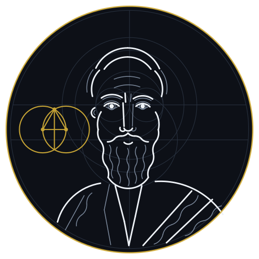

:site_title: Euclid of Alexandria

.. container:: author-overline

   semantic digital archive • the works of

====================
Euclid of Alexandria
====================

:person:`Euclid of Alexandria <euclid>` (fl. c. 300 BCE) laid the axiomatic and analytic foundations of classical mathematics, shaping twenty-three centuries of deductive thought. This archive brings together his two enduring geometric masterworks—Sir Thomas L. Heath's monumental three-volume English edition of the *Elements* and a bilingual critical edition of the *Data*—with every definition, proposition, and proof linked to primary-source folios and interactive vector diagrams.

Works in This Archive
---------------------

.. container:: home-book-hero

   .. container:: home-book-thumb

      .. image:: heath/volume_I/book_i/propositions/47/0363.g1.svg
         :alt: Euclid Book I, Proposition 47 — The Pythagorean Theorem
         :target: heath/index.html

   .. container:: home-book-body

      .. rubric:: Heath Critical Edition · 1926 · 3 Volumes · 13 Books

      **The Thirteen Books of Euclid's Elements** — Translated from J. L. Heiberg's critical Greek text with extensive historical introduction and mathematical commentary by Sir Thomas Little Heath, spanning plane geometry, proportion, number theory, incommensurables, and solid polyhedra across **831 calibrated diagrams**.

      .. container:: home-actions

         * :doc:`Open the Elements → <heath/index>`
         * :doc:`Start at Volume I → <heath/volume_I/index>`
         * :doc:`Book I, Prop. 1 → <heath/volume_I/book_i/propositions/01/index>`

.. container:: home-book-hero

   .. container:: home-book-thumb plate-light

      .. image:: _static/figures/data_08_functional_dag.svg
         :alt: Functional Dependency Architecture of Euclid's Data
         :target: data/index.html

   .. container:: home-book-body

      .. rubric:: Bilingual Edition · Menge 1896 & Simson 1806 · 15 Definitions · 94 Propositions

      **Euclid's Data (Δεδομένα)** — Euclid's companion treatise to the *Elements* and the gateway to the ancient *Treasury of Analysis*, establishing when magnitudes, ratios, angles, and positions are uniquely determined—prefaced by Marinus of Neapolis's *Protheoria*.

      .. container:: home-actions

         * :doc:`Open Euclid's Data → <data/index>`
         * :doc:`Read the Protheoria → <data/protheoria/index>`
         * :doc:`Explore Definitions → <data/definitions/index>`

Key Features
------------

.. container:: home-feature-grid

   .. container:: home-feature-card

      **831 Calibrated Geometric Diagrams**

      Every figure across the *Elements* and *Data* is vectorized directly from archival plates with interactive hover wiring between labels, geometric primitives, and steps in the proof.

   .. container:: home-feature-card

      **Synchronized Multi-Track Reading**

      Compare propositions side by side with Heath's extensive historical commentary in the *Elements*, or switch between English and Menge's Greek text in the *Data*.

   .. container:: home-feature-card

      **Primary-Source Folio Provenance**

      Each section, definition, and theorem carries direct page-level provenance badges linking back to scanned archival folios and explicit cross-proposition justifications.

Reference & Project
-------------------

.. container:: home-columns

   .. container:: home-col

      .. rubric:: Scholarly Apparatus

      * :doc:`People <people/index>` — Prosopographical directory of Euclid, Heiberg, Heath, Marinus, Menge, and Simson
      * :doc:`Bibliography <bibliography>` — Critical Greek texts, translations, and scholarly editions
      * :doc:`Data Concordance <data/concordance>` & :doc:`Glossary <heath/glossary>` — Cross-edition numbering and technical Greek terms

   .. container:: home-col

      .. rubric:: About This Project

      * :doc:`About <about/index>` — Editorial methodology, corpus scope, and connection to GEOMETOR
      * :doc:`Using This Edition <usage/index>` — Reading guide, track switching, and interactive diagram controls
      * :doc:`Log <log/index>` & :doc:`Modules <modules/index>` — Development notes and Python package documentation

.. toctree::
   :hidden:
   :maxdepth: 2

   heath/index
   data/index
   people/index
   bibliography
   about/index
   usage/index
   log/index
   modules/index