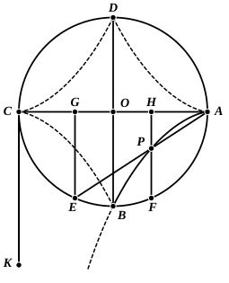

The difficulty which I see in this interpretation is the fact that, just after “three lines on *five* sections” are mentioned, Proclus describes three curves which were evidently the most important ; but these three belong to *three* of the five sections of the open tore, and are not separate from them.

#### 4. The cissoid.

This curve is assumed to be the same as that by means of which, according to Eutocius (*Comm. on Archimedes*, III. p. 66 sqq.), Diocles in his book περὶ πυρείων (*On burning-glasses*) solved the problem of doubling the cube. It is the locus of points which he found by the following construction. Let $AC$, $BD$ be diameters at right angles in a circle with centre $O$.

Let $E$, $F$ be points on the quadrants $BC$, $BA$ respectively such that the arcs $BE$, $BF$ are equal.

Draw $EG$, $FH$ perpendicular to $CA$. Join $AE$, and let $P$ be its intersection with $FH$.

The cissoid is the locus of all the points $P$ corresponding to different positions of $E$ on the quadrant $BC$ and of $F$ at an equal distance from $B$ along the arc $BA$.

$A$ is the point on the curve corresponding to the position $C$ for the point $E$, and $B$ the point on the curve corresponding to the position of $E$ in which it coincides with $B$.

It is easy to see that the curve extends in the direction $AB$ beyond $B$, and that $CK$ drawn perpendicular to $CA$ is an asymptote. It may be regarded also as having a branch $AD$ symmetrical with $AB$, and, beyond $D$, approaching $KC$ produced as asymptote.

If $OA$, $OD$ are coordinate axes, the equation of the curve is obviously
$$y^2 (a + x) = (a - x)^3,$$
where $a$ is the radius of the circle.

There is a cusp at $A$, and it agrees with this that Proclus should say (p. 126, 24) that “cissoidal lines converging to one point like the leaves of ivy—for this is the origin of their name—form an angle.” He makes the slight correction (p. 128, 5) that it is not two *parts* of a curve, but *one* curve, which in this case makes an angle.

But what is surprising is that Proclus seems to have no idea of the curve passing outside the circle and having an asymptote, for he several times speaks of it as a *closed* curve (forming a figure and including an area) : cf. p. 152, 7, “the plane (area) cut off by the cissoidal line has one bounding (line), but it has not in it a centre such that all (straight lines drawn to the curve) from it are equal.” It would appear as if Proclus regarded the cissoid as formed by the *four* symmetrical cissoidal arcs shown in the figure.

Even more peculiar is Proclus’ view of the

#### 5. “Single-turn Spiral.”

This is really the spiral of Archimedes traced by a point starting from the fixed extremity of a straight line and moving uniformly along it, while
