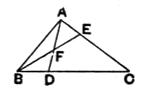
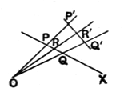

since the plane is the field, as it were, of almost all the rest of geometry, while a proper conception of it is necessary to enable Eucl. I. 1 to be understood, it might have been expected that the theory of the plane would have been the subject of at least the same amount of attention as, say, that of parallels. This however was far from being the case, perhaps because the subject of parallels (which, for the rest, presuppose the notion of a plane) is *much easier* than that of the plane. The nature of the difficulties as regards the plane have also been pointed out recently by Mr Frankland (*The First Book of Euclid's Elements*, Cambridge, 1905): it would appear that, whatever definition is taken, whether the simplest (as containing the minimum necessary to determine a plane) or the more complex, e.g. Simson's, some postulate has to be assumed in addition before the fundamental properties, or the truth of the other definitions, can be established. Crelle notes the same thing as regards Simson's definition, containing *more* than is necessary. Suppose a plane in which lies the triangle *ABC*. *Let AD join the vertex A to any point D on BC, and BE the vertex B to any point E on CA*. Then, according to the definition, *AD* lies wholly in the plane of the triangle; so does *BE*. But, if both *AD* and *BE* are to lie wholly in the one plane, *AD*, *BE* must intersect, say at *F*: if they did not, there would be two planes in question, not one. But the fact that the lines intersect and that, say, *AD* does not pass above or below *BE*, is by no means self-evident.

Mr Frankland points out the similar difficulty as regards the simpler definition of a plane as the surface generated by a straight line passing always through a fixed point and always intersecting a fixed straight line. Let *OPP'*, *OQQ'* drawn from *O* intersect the straight line *X* at *P*, *Q* respectively. *Let R be any third point on X: then it needs to be proved that OR intersects P'Q' in some point, say R'*. Without some postulate, however, it is not easy to see how to prove this, or even to prove that *P'Q'* intersects *X*.

### Crelle's essay. Definitions by Fourier, Deahna, Becker.

Crelle takes as the standard of a good definition that it shall be, not only as simple as possible, but also the best adapted for deducing, with the aid of the simplest possible principles, further properties belonging to the thing defined. He was much attracted by a very lucid definition, due, he says, to Fourier, according to which *a plane is formed by the aggregate of all the straight lines which, passing through one point on a straight line in space, are perpendicular to that straight line*. (This is really no more than an adaptation from Euclid's proposition XI. 5, to the effect that, if one of four concurrent straight lines be at right angles to each of the other three, those three are in one plane, which proposition is also used in Aristotle, *Meteorologica* III. 3, 373 a 13.) But Crelle confesses that he had not been able to deduce the necessary properties from this and had had to substitute the definition, already mentioned, of a plane as *the surface containing, throughout their whole length, all the straight lines passing through a fixed point and also intersecting a straight line in space*; and he only claims to have proved, after a long series of propositions, that the "Fourier"- or "perpendicular"-surface and the *plane* of the other definition just given are identical, after which the properties of the "Fourier"-surface can be used along with those of the plane. The advantage of the Fourier definition is that it leads easily, by means of the two propositions that
