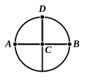

triangles are equal in all respects (1) when two sides and the included angle are respectively equal and (2) when all three sides are respectively equal, to the property expressed in Simson's definition. But Crelle uses to establish these two congruence-theorems a number of propositions about *equal angles*, *supplementary angles*, *right angles*, *greater* and *less angles*; and it is difficult to question the soundness of Schotten's criticism that these notions in themselves really presuppose that of a plane. The difficulty due to Fourier's use of the word "perpendicular," if that were all, could no doubt be got over. Thus Deahna in a dissertation (Marburg, 1837) constructed a plane as follows. Presupposing the notions of a straight line and a sphere, he observes that, if a sphere revolve about a diameter, all the points of its surface which move describe closed curves (circles). Each of these circles, during the revolution, moves along itself, and one of them divides the surface of the sphere into two congruent parts. The aggregate then of the lines joining the centre to the points of this circle forms the *plane*. Again, J. K. Becker (*Die Elemente der Geometrie*, 1877) pointed out that the revolution of a right angle about one side of it produces a conical surface which differs from all other conical surfaces generated by the revolution of other angles in the fact that *the particular cone coincides with the cone vertically opposite to it*: this characteristic might therefore be taken in order to get rid of the use of the right angle.

### W. Bolyai and Lobachewsky.

Very similar to Deahna's equivalent for Fourier's definition is the device of W. Bolyai and Lobachewsky (described by Frischauf, *Elemente der absoluten Geometrie*, 1876). They worked upon a fundamental idea first suggested, apparently, by Leibniz. Briefly stated, their way of evolving a *plane* and a *straight line* was as follows. Conceive an infinite number of pairs of concentric spheres described about two fixed points in space, $O$, $O'$, as centres, and with equal radii, gradually increasing: these pairs of equal spherical surfaces intersect respectively in homogeneous curves (circles), and the "Inbegriff" or aggregate of these curves of intersection forms a *plane*. If $A$ be a point on one of these circles ($k$ say), suppose points $M$, $M'$ to start simultaneously from $A$ and to move in opposite directions *at the same speed* till they meet at $B$, say: $B$ then is "opposite" to $A$, and $A$, $B$ divide the circumference into two equal halves. If the points $A$, $B$ be held fast and the whole system be turned about them until $O$ takes the place of $O'$, and $O'$ of $O$, the circle $k$ will occupy the same position as before (though turned a different way). Two opposite points, $P$, $Q$ say, of each of the other circles will remain stationary during the motion as well as $A$, $B$: the "Inbegriff" or aggregate of all such points which remain stationary forms a *straight line*. It is next observed that the *plane* as defined can be generated by the revolution of the straight line about $OO'$, and this suggests the following construction for a plane. Let a circle as one of the curves of intersection of the pairs of spherical surfaces be divided as before into two equal halves at $A$, $B$. Let the arc $ADB$ be similarly bisected at $D$, and let $C$ be the middle point of $AB$. This determines a straight line $CD$ which is then defined as "perpendicular" to $AB$. The revolution of $CD$ about $AB$ generates a *plane*. The property stated in Simson's definition is then proved by means of the congruence-theorems proved in Eucl. I. 8 and I. 4. The first is taken as proved, practically by considerations of symmetry and homogeneity. If two spherical surfaces, not necessarily equal, with centres $O$, $O'$ intersect, $A$ and its "opposite" point $B$ are taken as

