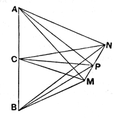

before on the curve of intersection (a circle) and, relatively to $OO'$, the point $A$ is taken to be convertible with $B$ or any other point on the homogeneous curve. The second (that of Eucl. I. 4) is established by simple application. Rausenberger objects to these proofs on the grounds that the first *assumes* that the two spherical surfaces intersect in one single curve, not in several, and that the second compares *angles* : a comparison which, he says, is possible only in a *plane*, so that a plane is really presupposed. Perhaps as regards the particular comparison of angles Rausenberger is hypercritical; but it is difficult to regard the supposed proof of the theorem of Eucl. I. 8 as sufficiently rigorous (quite apart from the use of the uniform *motion* of points for the purpose of bisecting lines).

Simson's property is proved from the two congruence-theorems thus. Suppose that $AB$ is "perpendicular" (as defined by Bolyai) to two generators $CM$, $CN$ of a plane, or suppose $CM$, $CN$ respectively to make with $AB$ two angles congruent with one another. It is enough to prove that, if $P$ be any point on the straight line $MN$, then $CP$, just as much as $CM$, $CN$ respectively, makes with $AB$ two angles congruent with one another and is therefore a generator. We prove successively the congruence of the following pairs of triangles :

$$ACM, \quad BCM$$
$$ACN, \quad BCN$$
$$AMN, \quad BMN$$
$$AMP, \quad BMP$$
$$ACP, \quad BCP,$$

whence the angles $ACP$, $BCP$ are congruent.

#### Other views.

Enriques and Amaldi (*Elementi di geometria*, Bologna, 1905), Veronese (in his *Elementi*) and Hilbert all assume as a *postulate* the property stated in Simson's definition. But G. Ingrami (*Elementi di geometria*, Bologna, 1904) proves it in the course of a remarkable series of closely argued proposition based upon a much less comprehensive postulate. He evolves the theory of the plane from that of a triangle, beginning with a triangle as a mere *three-side* (trilatero), i.e. a *frame*, as it were. His postulate relates to the *three-side* and is to the effect that each "(rectilineal) segment" joining a vertex to a point of the opposite side meets every segment similarly joining each of the other two vertices to the points of the sides opposite to them respectively, and, conversely, if a point be taken on a segment joining a vertex to a point of the opposite side, and if a straight line be drawn from another vertex to the point on the segment so taken, it will if produced meet the opposite side. A *triangle* is then defined as the figure formed by the aggregate of all the segments joining the respective vertices of a *three-side* to points on the opposite sides. After a series of propositions, Ingrami evolves a plane as *the figure formed by the "half straight-lines" which project from an internal point of the triangle the points of the perimeter*, and then, after two more theorems, proves that a plane is determined by any three of its points which are not in a straight line, and that *a straight line which has two points in a plane has all its points in it*.

The argument by which Bolyai and Lobachewsky evolved the plane is of course equivalent to the definition of a plane as *the locus of all points equidistant from two fixed points in space*.
