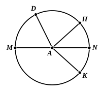

the portion $MNKM$ of the circle turned about the fixed points $M, N$, so that it ultimately comes near to or coincides with the remaining portion $MNHDM$.

“Then (i) the whole diameter $MAN$, with all its points, clearly remains in the same position, since otherwise two straight lines would enclose a space (contrary to the first Lemma).

“(ii) Clearly no point $K$ of the circumference $NKM$ falls within or outside the surface enclosed by the diameter $MAN$ and the other part, $NHDM$, of the circumference, since otherwise, contrary to the nature of the circle, a radius as $AK$ would be less or greater than another radius as $AH$.

“(iii) Any radius $MA$ can clearly be rectilineally produced only along a single other radius $AN$, since otherwise (contrary to the second Lemma) two lines assumed straight, e.g. $MAN$, $MAH$, would have one and the same common segment.

“(iv) All diameters of the circle obviously cut one another in the centre (Lemma 3 preceding), and they bisect one another there, by the general properties of the circle.

“From all this it is manifest that the diameter $MAN$ divides its circle and the circumference of it just exactly into two equal parts, and the same may be generally asserted for every diameter whatsoever of the same circle; which was to be proved.”

Simson observes that the property is easily deduced from III. 31 and 24; for it follows from III. 31 that the two parts of the circle are “similar segments” of a circle (segments containing equal angles, III. Def. 11), and from III. 24 that they are equal to one another.

---

### DEFINITION 18.

Ἡμικύκλιον δέ ἐστι τὸ περιεχόμενον σχῆμα ὑπό τε τῆς διαμέτρου καὶ τῆς ἀπολαμβανομένης ὑπ’ αὐτῆς περιφερείας. κέντρον δὲ τοῦ ἡμικυκλίου τὸ αὐτό, ὃ καὶ τοῦ κύκλου ἐστίν.

*A semicircle is the figure contained by the diameter and the circumference cut off by it. And the centre of the semicircle is the same as that of the circle.*

---

The last words, “And the centre of the semicircle is the same as that of the circle,” are added from Proclus to the definition as it appears in the MSS. Scarburgh remarks that a semicircle has no centre, properly speaking, and thinks that the words are not Euclid's, but only a note by Proclus. I am however inclined to think that they are genuine, if only because of the very futility of an observation added by Proclus. He explains, namely, that the semicircle is the only plane figure that has its centre on its perimeter (!), “so that you may conclude that the centre has three positions, since it may be within the figure, as in the case of a circle, or on the perimeter, as with the semicircle, or outside, as with some conic lines (the single-branch hyperbola presumably)”!

Proclus and Simplicius point out that, in the order adopted by Euclid for these definitions of figures, the first figure taken is that bounded by *one* line (the circle), then follows that bounded by *two* lines (the semicircle), then the triangle, bounded by *three* lines, and so on. Proclus, as usual, distinguishes
