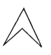

applies the term "scalene" to an *odd* number in contrast to "isosceles" used of an even number. Proclus (p. 168, 24) seems to connect it with σκάζω, to *limp*; others make it akin to σκολιός, *crooked*, *aslant*. Apollonius uses the same word "scalene" of an *oblique* circular cone.

Triangles are classified, first with reference to their sides, and then with reference to their angles. Proclus points out that seven distinct species of triangles emerge: (1) the *equilateral* triangle, (2) three species of *isosceles* triangles, the right-angled, the obtuse-angled and the acute-angled, (3) the same three varieties of *scalene* triangles.

Proclus gives an odd reason for the dual classification according to sides and angles, namely that Euclid was mindful of the fact that it is not every *triangle* that is *trilateral* also. He explains this statement by reference (p. 165, 22) to a figure which some called *barb-like* (ἀκιδοειδής) while Zenodorus called it *hollow-angled* (κοιλογώνιος). Proclus mentions it again in his note on I. 22 (p. 328, 21 sqq.) as one of the paradoxes of geometry, observing that it is seen in the figure of that proposition. This "triangle" is merely a *quadrilateral* with a re-entrant angle; and the idea that it has only three angles is due to the non-recognition of the fourth angle (which is greater than two right angles) as being an angle at all. Since Proclus speaks of the *four-sided triangle* as "one of the paradoxes in geometry," it is perhaps not safe to assume that the misconception underlying the expression existed in the mind of Proclus alone; but there does not seem to be any evidence that Zenodorus called the figure in question a triangle (cf. Pappus, ed. Hultsch, pp. 1154, 1206).

---

### DEFINITION 22.

Τῶν δὲ τετραπλεύρων σχημάτων τετράγωνον μέν ἐστιν, ὃ ἰσόπλευρόν τέ ἐστι καὶ ὀρθογώνιον, ἑτερόμηκες δέ, ὃ ὀρθογώνιον μέν, οὐκ ἰσόπλευρον δέ, ῥόμβος δέ, ὃ ἰσόπλευρον μέν, οὐκ ὀρθογώνιον δέ, ῥομβοειδὲς δὲ τὸ τὰς ἀπεναντίον πλευράς τε καὶ γωνίας ἴσας ἀλλήλαις ἔχον, ὃ οὔτε ἰσόπλευρόν ἐστιν οὔτε ὀρθογώνιον· τὰ δὲ παρὰ ταῦτα τετράπλευρα τραπέζια καλείσθω.

*Of quadrilateral figures, a* **square** *is that which is both equilateral and right-angled; an* **oblong** *that which is right-angled but not equilateral; a* **rhombus** *that which is equilateral but not right-angled; and a* **rhomboid** *that which has its opposite sides and angles equal to one another but is neither equilateral nor right-angled. And let quadrilaterals other than these be called* **trapezia**.

---

τετράγωνον was already a *square* with the Pythagoreans (cf. Aristotle, *Metaph.* 986 a 26), and it is so most commonly in Aristotle; but in *De anima* II. 3, 414 b 31 it seems to be a quadrilateral, and in *Metaph.* 1054 b 2, "equal and equiangular τετράγωνα," it cannot be anything else but quadrilateral if "equiangular" is to have any sense. Though, by introducing τετράπλευρον for any quadrilateral, Euclid enabled ambiguity to be avoided, there seem to be traces of the older vague use of τετράγωνον in much later writers. Thus Heron (Def. 100) speaks of a cube as "contained by six equilateral and *equiangular* τετράγωνα" and Proclus (p. 166, 10) adds to his remark about the "four-sided triangle" that "you might have τετράγωνα with more than the four sides," where τετράγωνα can hardly mean squares.

ἑτερόμηκες, *oblong* (with sides of *different length*), is also a Pythagorean term.

The word *right-angled* (ὀρθογώνιον) as here applied to quadrilaterals must mean *rectangular* (i.e., practically, having all its angles right angles); for, although it is tempting to take the word in the same sense for a
