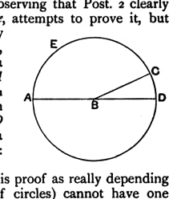
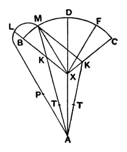

triangle which is equal to it, and it is inferred that the two coincide throughout their length: this would by no means follow if two straight lines could have a common segment. Proclus (p. 215, 24), while observing that Post. 2 clearly indicates that the produced portion must be *one*, attempts to prove it, but unsuccessfully. Both he and Simplicius practically use the same argument. Suppose, says Proclus, that the straight lines $AC$, $AD$ have $AB$ as a common segment. With centre $B$ and radius $BA$ describe a circle (Post. 3) meeting $AC$, $AD$ in $C$, $D$. Then, since $ABC$ is a straight line through the centre, $AEC$ is a semi-circle. Similarly, $ABD$ being a straight line through the centre, $AED$ is a semi-circle. Therefore $AEC$ is equal to $AED$: which is impossible.

Proclus observes that Zeno would object to this proof as really depending on the assumption that "two circumferences (of circles) cannot have one portion common"; for this, he would say, is assumed in the common proof by superposition of the fact that a circle is bisected by a diameter, since that proof takes it for granted that, if one part of the circumference cut off by the diameter, when applied to the other, does not coincide with it, it must necessarily fall either *entirely* outside or *entirely* inside it, whereas there is nothing to prevent their coinciding, not altogether, but in part only; and, until you really prove the bisection of a circle by its diameter, the above proof is not valid. Posidonius is represented as having derided Zeno for not seeing that the proof of the bisection of a circle by its diameter goes on just as well if the circumferences fail to coincide *in part* only. But the true objection to the proof above given is that the proof of the bisection of a circle by any diameter *itself* assumes that two straight lines cannot have a common segment; for, if we wish to draw the diameter of a circle which has its extremity at a given point of the circumference we have to join the latter point to the centre (Post. 1) and then to *produce* the straight line so drawn till it meets the circle again (Post. 2), and it is necessary for the proof that the produced part shall be *unique*.

Saccheri adopted the proper order when he gave, first the proposition that two straight lines cannot have a common segment, and after that the proposition that any diameter of a circle bisects the circle and its circumference.

Saccheri's proof of the former is very interesting as showing the thoroughness of his method, if not at the end entirely convincing. It is in five stages which I shall indicate shortly, giving the full argument of the first only.

Suppose, if possible, that $AX$ is a common segment of both the straight lines $AXB$, $AXC$, in one plane, produced beyond $X$. Then describe about $X$ as centre, with radius $XB$ or $XC$, the arc $BMC$, and draw through $X$ to any point on it the straight line $XM$.

(i) I maintain that, with the assumption made, *the line $AXM$ is also a straight line which is drawn from the point $A$ to the point $X$ and produced beyond $X$*.

For, if this line were not straight, we could draw another straight line $AM$ which for its part would be straight. This straight line will either (*a*) cut one of the two straight lines $XB$, $XC$ in a certain point $K$ or (*b*) enclose one of them, for instance $XB$, in the area bounded by $AX$, $XM$ and $APLM$.
