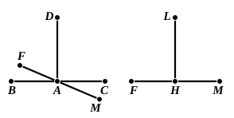

Suppose now that $DA$ standing on $BAC$ makes the two angles $DAB, DAC$ equal, so that each is a right angle by the definition.
Similarly, let $LH$ form with the straight line $FHM$ the right angles $LHF, LHM$.
Let $DA, HL$ be equal; and suppose the whole of the second figure so laid upon the first that the point $H$ falls on $A$, and $L$ on $D$.
Then the straight line $FHM$ will (by the third lemma) not *touch* the straight line $BC$ at $A$; it will either
(*a*) coincide exactly with $BC$, or
(*b*) *cut* it so that one of its extremities, as $F$, will fall above [$BC$] and the other, $M$, below it.

If the alternative (*a*) is true, we have already proved the exact equality of all rectilineal right angles.
Under alternative (*b*) we prove that the angle $LHF$, being equal to the angle $DAF$, is less than the angle $DAB$ or $DAC$, and *a fortiori* less than the angle $DAM$ or $LHM$: which is contrary to the hypothesis.
[Hence (*a*) is the only possible alternative, so that all right angles are equal.]
Saccheri adds that it makes no difference if the angle $DAF$ diverges *infinitely little* from the angle $DAB$. This would equally lead to a conclusion contradicting the hypothesis.
It will be observed that Saccheri speaks of "the exact equality of all *rectilineal* right angles." He may have had in mind the remark of Pappus, quoted by Proclus (p. 189, 11), that the converse of this postulate, namely that an angle which is equal to a right angle is also right, is not necessarily true, unless the former angle is *rectilineal*. Suppose two equal straight lines $BA, BC$ at right angles to one another, and semi-circles described on $BA, BC$ respectively as $AEB, BDC$ in the figure. Then, since the semi-circles are equal, they coincide if applied to one another. Hence the "angles" $EBA, DBC$ are equal. Add to each the "angle" $ABD$; and it follows that the *lunular* angle $EBD$ is equal to the right angle $ABC$. (Similarly, if $BA, BC$ be inclined at an acute or obtuse angle, instead of at a right angle, we find a *lunular* angle equal to an acute or obtuse angle.) This is one of the curiosities which Greek commentators delighted in.

Veronese, Ingrami, and Enriques and Amaldi deduce the fact that *all right angles are equal* from the equivalent fact that *all flat angles are equal*, which is either itself assumed as a postulate or immediately deduced from some other postulate.
Hilbert takes quite a different line. He considers that Euclid did wrong in placing Post. 4 among "axioms." He himself, after his Group III. of Axioms containing six relating to congruence, proves several theorems about the congruence of triangles and angles, and then deduces our Postulate.
As to the *raison d'être* and the place of Post. 4 one thing is quite certain. It was essential from Euclid's point of view that it should come before Post. 5, since the condition in the latter that a certain pair of angles are together less than two right angles would be useless unless it were first made clear that right angles are angles of determinate and invariable magnitude.
