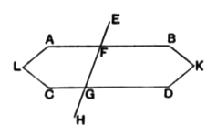

Simplicius adds in full and word for word the attempt of his "friend" or his "master Aganis" to prove the Postulate.
Proclus returns to the subject (p. 365, 5) in his note on Eucl. I. 29. He says that before his time a certain number of geometers had classed as a theorem this Euclidean postulate and thought it matter for proof, and he then proceeds to give an account of Ptolemy's argument.

#### **Noteworthy attempts to prove the Postulate.**

##### **Ptolemy.**

We learn from Proclus (p. 365, 7—11) that Ptolemy wrote a book on the proposition that "straight lines drawn from angles less than two right angles meet if produced," and that he used in his "proof" many of the theorems in Euclid preceding I. 29. Proclus excuses himself from reproducing the early part of Ptolemy's argument, only mentioning as one of the propositions proved in it the theorem of Eucl. I. 28 that, if two straight lines meeting a transversal make the two interior angles on the same side equal to two right angles, the straight lines do not meet, however far produced.
I. From Proclus' note on I. 28 (p. 362, 14 sq.) we know that Ptolemy proved this somewhat as follows.
Suppose that there are two straight lines $AB, CD$, and that $EFGH$, meeting them, makes the angles $BFG, FGD$ equal to two right angles. I say that $AB, CD$ are parallel, that is, they are non-secant.
For, if possible, let $FB, GD$ meet at $K$.
Now, since the angles $BFG, FGD$ are equal to two right angles, while the four angles $AFG, BFG, FGD, FGC$ are together equal to four right angles,
the angles $AFG, FGC$ are equal to two right angles.

"*If therefore* $\text{FB}, \text{GD}$, *when the interior angles are equal to two right angles, meet at* $\text{K}$, *the straight lines* $\text{FA}, \text{GC}$ *will also meet if produced*; for the angles $AFG, CGF$ are also equal to two right angles.
"Therefore the straight lines will either meet in both directions or in neither direction, if the two pairs of interior angles are both equal to two right angles.
"Let, then, $FA, GC$ meet at $L$.
"Therefore the straight lines $LABK, LCDK$ enclose a space: which is impossible.
"Therefore it is not possible for two straight lines to meet when the interior angles are equal to two right angles. Therefore they are parallel."
[The argument in the words italicised would be clearer if it had been shown that the two interior angles on one side of $EH$ are *severally* equal to the two interior angles on the other, namely $BFG$ to $CGF$ and $FGD$ to $AFG$; whence, assuming $FB, GD$ to meet in $K$, we can take the triangle $KFG$ and place it (e.g. by rotating it in the plane about $O$ the middle point of $FG$) so that $FG$ falls where $GF$ is in the figure and $GD$ falls on $FA$, in which case $FB$ must also fall on $GC$; hence, since $FB, GD$ meet at $K$, $GC$ and $FA$ must meet at a corresponding point $L$. Or, as Mr Frankland does, we may substitute for $FG$ a straight line $MN$ through $O$ the middle point of $FG$ drawn perpendicular to one of the parallels, say $AB$. Then, since the two triangles $OMF, ONG$ have two angles equal respectively, namely $FOM$ to
