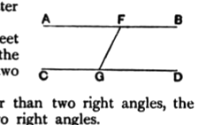

$GON$ (I. 15) and $OFM$ to $OGN$, and one side $OF$ equal to one side $OG$, the triangles are congruent, the angle $ONG$ is a right angle, and $MN$ is perpendicular to both $AB$ and $CD$. Then, by the same method of application, $MA$, $NC$ are shown to form with $MN$ a triangle $MALCN$ congruent with the triangle $NDKBM$, and $MA$, $NC$ meet at a point $L$ corresponding to $K$. Thus the two straight lines would meet at the *two* points $K$, $L$. This is what happens under the Riemann hypothesis, where the axiom that two straight lines cannot enclose a space does not hold, but all straight lines meeting in one point have another point common also, and e.g. in the particular figure just used $K$, $L$ are points common to all perpendiculars to $MN$. If we suppose that $K$, $L$ are not distinct points, but *one* point, the axiom that two straight lines cannot enclose a space is *not* contradicted.]

II. Ptolemy now tries to prove I. 29 without using our Postulate, and then deduces the Postulate from it (Proclus, pp. 365, 14—367, 27).

The argument to prove I. 29 is as follows.

The straight line which cuts the parallels must make the sum of the interior angles on the same side equal to, greater than, or less than, two right angles.

"Let $AB$, $CD$ be parallel, and let $FG$ meet them. I say (1) that $FG$ does not make the interior angles on the same side greater than two right angles.

"For, if the angles $AFG$, $CGF$ are greater than two right angles, the remaining angles $BFG$, $DGF$ are less than two right angles.

"But the same two angles are also greater than two right angles; *for $\text{AF}$, $\text{CG}$ are no more parallel than $\text{FB}$, $\text{GD}$, so that, if the straight line falling on $\text{AF}$, $\text{CG}$ makes the interior angles greater than two right angles, the straight line falling on $\text{FB}$, $\text{GD}$ will also make the interior angles greater than two right angles.*

"But the same angles are also less than two right angles; for the four angles $AFG$, $CGF$, $BFG$, $DGF$ are equal to four right angles:

which is impossible.

"Similarly (2) we can show that the straight line falling on the parallels does not make the interior angles on the same side less than two right angles.

"But (3), if it makes them neither greater nor less than two right angles, it can only make the interior angles on the same side *equal* to two right angles."

III. Ptolemy deduces Post. 5 thus:

Suppose that the straight lines making angles with a transversal less than two right angles do not meet on the side on which those angles are.

Then, *a fortiori*, they will not meet on the other side on which are the angles *greater* than two right angles.

Hence the straight lines will not meet in either direction; they are therefore *parallel*.

But, if so, the angles made by them with the transversal are equal to two right angles, by the preceding proposition ($=$ I. 29).

Therefore the same angles will be both equal to and less than two right angles:

which is impossible.

Hence the straight lines will meet.
