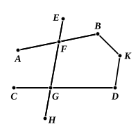

IV. Ptolemy lastly enforces his conclusion that the straight lines will meet *on the side on which are the angles less than two right angles* by recurring to the *a fortiori* step in the foregoing proof.

Let the angles $AFG$, $CGF$ in the accompanying figure be together less than two right angles.

Therefore the angles $BFG$, $DGF$ are greater than two right angles.

We have proved that the straight lines are not non-secant.

If they meet, they must meet either towards $A$, $C$, or towards $B$, $D$.

(1) Suppose they meet towards $B$, $D$, at $K$.

Then, since the angles $AFG$, $CGF$ are less than two right angles, and the angles $AFG$, $GFB$ are equal to two right angles, take away the common angle $AFG$, and

the angle $CGF$ is less than the angle $BFG$;

that is, the exterior angle of the triangle $KFG$ is less than the interior and opposite angle $BFG$:

which is impossible.

Therefore $AB$, $CD$ do not meet towards $B$, $D$.

(2) But they do meet, and therefore they must meet in one direction or the other:

therefore they meet towards $A$, $B$, that is, on the side where are the angles less than two right angles.

The flaw in Ptolemy's argument is of course in the part of his proof of I. 29 which I have italicised. As Proclus says, he is not entitled to assume that, if $AB$, $CD$ are parallel, whatever is true of the interior angles on one side of $FG$ (i.e. that they are together equal to, greater than, or less than, two right angles) is necessarily true at the same time of the interior angles on the other side. Ptolemy justifies this by saying that $FA$, $GC$ are no more parallel in one direction than $FB$, $GD$ are in the other: which is equivalent to the assumption that *through any point only one parallel can be drawn to a given straight line*. That is, he assumes an equivalent of the very Postulate he is endeavouring to prove.

### Proclus.

Before passing to his own attempt at a proof, Proclus (p. 368, 26 sqq.) examines an ingenious argument (recalling somewhat the famous one about Achilles and the tortoise) which appeared to show that it was *impossible* for the lines described in the Postulate to meet.

Let $AB$, $CD$ make with $AC$ the angles $BAC$, $ACD$ together less than two right angles.

Bisect $AC$ at $E$ and along $AB$, $CD$ respectively measure $AF$, $CG$ so that each is equal to $AE$.

Bisect $FG$ at $H$ and mark off $FK$, $GL$ each equal to $FH$; and so on.

Then $AF$, $CG$ will not meet at any point on $FG$; for, if that were the case, two sides of a triangle would be together equal to the third: which is impossible.
