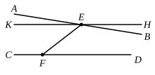

II. "Having proved this, we shall prove, as a deduction from it, the theorem in question.

"For let $AB$, $CD$ be two straight lines, and let $EF$ falling on them make the angles $BEF$, $DFE$ less than two right angles.

"I say that the straight lines will meet on that side on which are the angles less than two right angles.

"For, since the angles $BEF$, $DFE$ are less than two right angles, let the angle $HEB$ be equal to the excess of two right angles (over them), and let $HE$ be produced to $K$.

"Since then $EF$ falls on $KH$, $CD$ and makes the two interior angles $HEF$, $DFE$ equal to two right angles,

the straight lines $HK$, $CD$ are parallel.

"And $AB$ cuts $KH$; therefore it will also cut $CD$, by what was before shown.

"Therefore $AB$, $CD$ will meet on that side on which are the angles less than two right angles.

"Hence the theorem is proved."

Clavius criticised this proof on the ground that the axiom from which it starts, taken from Aristotle, itself requires proof. He points out that, just as you cannot assume that two lines which continually approach one another will meet (witness the hyperbola and its asymptote), so you cannot assume that two lines which continually diverge will ultimately be so far apart that a perpendicular from a point on one let fall on the other will be greater than any assigned distance; and he refers to the *conchoid* of Nicomedes, which continually approaches its asymptote, and therefore continually gets farther away from the tangent at the vertex; yet the perpendicular from any point on the curve to that tangent will always be less than the distance between the tangent and the asymptote. Saccheri supports the objection.

Proclus' first proposition is open to the objection that it assumes that two "parallels" (in the Euclidean sense) or, as we may say, two straight lines which have a common perpendicular, are (not necessarily equidistant, but) so related that, when they are produced indefinitely, the perpendicular from a point of one upon the other remains finite.

This last assumption is incorrect on the hyperbolic hypothesis; the "axiom" taken from Aristotle does not hold on the elliptic hypothesis.

### Naṣīraddīn aṭ-Ṭūsī.

The Persian-born editor of Euclid, whose date is 1201—1274, has three lemmas leading up to the final proposition. Their content is substantially as follows, the first lemma being apparently assumed as evident.

I. (*a*) If $AB$, $CD$ be two straight lines such that successive perpendiculars, as $EF$, $GH$, $KL$, from points on $AB$ to $CD$ always make with $AB$ unequal angles, which are always acute on the side towards $B$ and always obtuse on the side towards $A$, then the lines $AB$, $CD$, so long as they do not cut, approach continually nearer in the direction of the acute angles and diverge continually in the direction of the obtuse angles, and the perpendiculars diminish towards $B$, $D$, and increase towards $A$, $C$.

(*b*) Conversely, if the perpendiculars so drawn continually become shorter in the direction of $B$, $D$, and longer in the
