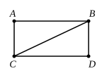
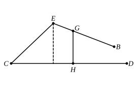

direction of $A$, $C$, the straight lines $AB$, $CD$ approach continually nearer in the direction of $B$, $D$ and diverge continually in the other direction; also each perpendicular will make with $AB$ two angles one of which is acute and the other is obtuse, and all the acute angles will lie in the direction towards $B$, $D$, and the obtuse angles in the opposite direction.

[Saccheri points out that even the first part (*a*) requires proof. As regards the converse (*b*) he asks, why should not the successive acute angles made by the perpendiculars with $AB$, while remaining acute, become greater and greater as the perpendiculars become smaller until we arrive at last at a perpendicular which is a common perpendicular to *both* lines? If that happens, all the author's efforts are in vain. And, if you are to assume the truth of the statement in the lemma without proof, would it not, as Wallis said, be as easy to assume as axiomatic the statement in Post. 5 without more ado?]

II. *If $\text{AC}$, $\text{BD}$ be drawn from the extremities of $\text{AB}$ at right angles to it and on the same side, and if $\text{AC}$, $\text{BD}$ be made equal to one another and $\text{CD}$ be joined, each of the angles $\text{ACD}$, $\text{BDC}$ will be right, and $\text{CD}$ will be equal to $\text{AB}$.*

The first part of this lemma is proved by *reductio ad absurdum* from the preceding lemma. If, e.g., the angle $ACD$ is not right, it must either be acute or obtuse.

Suppose it is acute; then, by lemma 1, $AC$ is greater than $BD$, which is contrary to the hypothesis. And so on.

The angles $ACD$, $BDC$ being proved to be right angles, it is easy to prove that $AB$, $CD$ are equal.

[It is of course assumed in this "proof" that, if the angle $ACD$ is acute, the angle $BDC$ is obtuse, and *vice versa*.]

III. *In any triangle the three angles are together equal to two right angles.*

This is proved for a *right-angled* triangle by means of the foregoing lemma, the four angles of the quadrilateral ">$ABCD$ of that lemma being all right angles. The proposition is then true for *any* triangle, since any triangle can be divided into two right-angled triangles.

IV. Here we have the final "proof" of Post. 5. Three cases are distinguished, but it is enough to show the case where one of the interior angles is right and the other acute.

Suppose $AB$, $CD$ to be two straight lines met by $FCE$ making the angle $ECD$ a right angle and the angle $CEB$ an acute angle.

Take any point $G$ on $EB$, and draw $GH$ perpendicular to $EC$.

Since the angle $CEG$ is acute, the perpendicular $GH$ will fall on the side of $E$ towards $D$, and will either coincide with $CD$ or not coincide with it. In the former case the proposition is proved.

If $GH$ does not coincide with $CD$ but falls on the side of it towards $F$, $CD$, being within the triangle formed by the perpendicular and by $CE$, $EG$, must cut $EG$. [An axiom is here used, namely that, if $CD$ be produced far enough, it must pass *outside* the triangle and therefore cut *some* side, which must be $EB$, since it cannot be the perpendicular (I. 27), or $CE$.]

Lastly, let $GH$ fall on the side of $CD$ towards $E$.
