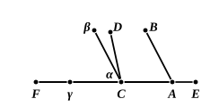
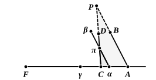

Along $HC$ set off $HK$, $KL$ etc., each equal to $EH$, until we get the first point of division, as $M$, beyond $C$.

Along $GB$ set off $GN$, $NO$ etc., each equal to $EG$, until $EP$ is the same multiple of $EG$ that $EM$ is of $EH$.

Then we can prove that the perpendiculars from $N$, $O$, $P$ on $EC$ fall on the points $K$, $L$, $M$ respectively.

For take the first perpendicular, that from $N$, and call it $NS$.

Draw $EQ$ at right angles to $EH$ and equal to $GH$, and set off $SR$ along $SN$ also equal to $GH$. Join $QG$, $GR$.

Then (second lemma) the angles $EQG$, $QGH$ are right, and $QG$ $=$ $EH$.

Similarly the angles $SRG$, $RGH$ are right, and $RG$ $=$ $SH$.

Thus $RGQ$ is one straight line, and the vertically opposite angles $NGR$, $EGQ$ are equal. The angles $NRG$, $EQG$ are both right, and $NG$ $=$ $GE$, by construction.

Therefore (I. 26) $RG$ $=$ $GQ$;

whence $SH$ $=$ $HE$ $=$ $KH$, and $S$ coincides with $K$.

We may proceed similarly with the other perpendiculars.

Thus $PM$ is perpendicular to $FE$. Hence $CD$, being parallel to $MP$ and within the triangle ">$PME$, must cut $EP$, if produced far enough.

### John Wallis.

As is well known, the argument of Wallis (1616—1703) assumed as a postulate that, *given a figure, another figure is possible which is similar to the given one and of any size whatever*. In fact Wallis assumed this for *triangles* only. He first proved (1) that, if a finite straight line is placed on an infinite straight line, and is then moved in its own direction as far as we please, it will always lie on the same infinite straight line, (2) that, if an angle be moved so that one leg always slides along an infinite straight line, the angle will remain the same, or equal, (3) that, if two straight lines, cut by a third, make the interior angles on the same side less than two right angles, each of the exterior angles is greater than the opposite interior angle (proved by means of I. 13).

(4) If $AB$, $CD$ make, with $AC$, the interior angles less than two right angles, suppose $AC$ (with $AB$ rigidly attached to it) to move along $AF$ to the position $\alpha\gamma$, such that $\alpha$ coincides with $C$. If $AB$ then takes the position $\alpha\beta$, *$\alpha\beta$ lies entirely outside $\text{CD}$* (proved by means of (3) above).

(5) With the same hypotheses, *the straight line $\alpha\beta$, or $\text{AB}$, during its motion, and before $\alpha$ reaches $\text{C}$, must cut the straight line $\text{CD}$*.

(6) Here is enunciated the postulate stated above.

(7) Postulate 5 is now proved thus.

Let $AB$, $CD$ be the straight lines which make, with the infinite straight line $ACF$ meeting them, the interior angles $BAC$, $DCA$ together less than two right angles.

Suppose $AC$ (with $AB$ rigidly attached to it) to move along $ACF$ until $AB$ takes the position of $\alpha\beta$ cutting $CD$ in $\pi$.

Then, ">$\alpha C\pi$ being a triangle, we can, by the above postulate, suppose a triangle drawn on the base $CA$ similar to the triangle ">$\alpha C\pi$.

Let it be ">$ACP$.

[Wallis here interposes a defence of the hypothetical construction.]
