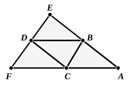

*not less* than two right angles to present great difficulties. He first observed that, as in the case of spherical triangles (in which the sum of the angles is greater than two right angles) the excess of the sum of the angles over two right angles is proportional to the area of the triangle, so in the case of rectilineal triangles, if the sum of the angles is less than two right angles by a certain *deficit*, the *deficit* will be proportional to the area of the triangle. Hence if, starting from a given triangle, we could construct another triangle in which the original triangle is contained at least $m$ times, the *deficit* of this new triangle will be equal to at least $m$ times that of the original triangle, so that the sum of the angles of the greater triangle will diminish progressively as $m$ increases, until it becomes zero or negative: which is absurd. The whole difficulty was thus reduced to that of the construction of a triangle containing the given triangle at least twice; but the solution of even this simple problem requires it to be assumed (or proved) that *through a given point within a given angle less than two-thirds of a right angle we can always draw a straight line which shall meet both sides of the angle*. This is however really equivalent to Euclid's Postulate. The proof in the course of which the necessity for the assumption appeared is as follows.

It is required to prove that the sum of the angles of a triangle cannot be *less* than two right angles.

Suppose $A$ is the least of the three angles of a triangle ">$ABC$. Apply to the opposite side $BC$ a triangle ">$DBC$, equal to the triangle ">$ACB$, and such that the angle $DBC$ is equal to the angle $ACB$, and the angle $DCB$ to the angle $ABC$; and *draw any straight line through $D$ cutting $AB$, $AC$ produced in $E$, $F$*.

If now the sum of the angles of the triangle ">$ABC$ is less than two right angles, being equal to $2R - \delta$ say, the sum of the angles of the triangle ">$DBC$, equal to the triangle ">$ABC$, is also $2R - \delta$.

Since the sum of the three angles of the remaining triangles ">$DEB$, ">$FDC$ respectively cannot at all events be *greater* than two right angles [for Legendre's proofs of this see below], the sum of the twelve angles of the four triangles in the figure *cannot be greater* than

$$4R + (2R - \delta) + (2R - \delta), \text{ i.e. } 8R - 2\delta.$$

Now the sum of the three angles at each of the points $B$, $C$, $D$ is $2R$.

Subtracting these nine angles, we have the result that the three angles of the triangle ">$AEF$ *cannot be greater* than $2R - 2\delta$.

Hence, if the sum of the angles of the triangle ">$ABC$ is less than two right angles by $\delta$, the sum of the angles of the larger triangle ">$AEF$ is less than two right angles by *at least* $2\delta$.

We can continue the construction, making a still larger triangle from ">$AEF$, and so on.

But, however small $\delta$ is, we can arrive at a multiple $2^n \delta$ which shall exceed any given angle and therefore $2R$ itself; so that the sum of the three angles of a triangle sufficiently large would be zero or even less than zero: which is absurd.

Therefore etc.

The difficulty caused by the necessity of making the above-mentioned assumption made Legendre abandon, in his ninth edition, the method of the
