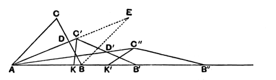

editions from the third to the eighth and return to Euclid's method pure and simple.

But again, in the twelfth, he returned to the plan of constructing any number of successive triangles such that the sum of the three angles in all of them remains equal to the sum of the three angles of the original triangle, but two of the angles of the new triangles become smaller and smaller, while the third becomes larger and larger; and this time he claims to prove in one proposition that the sum of the three angles of the original triangle is *equal* to two right angles by continuing the construction of new triangles *indefinitely* and compressing the two smaller angles of the ultimate triangle into nothing, while the third angle is made to become a *flat* angle at the same time. The construction and attempted proof are as follows.

Let $ABC$ be the given triangle; let $AB$ be the greatest side and $BC$ the least; therefore $C$ is the greatest angle and $A$ the least.

From $A$ draw $AD$ to the middle point of $BC$, and produce $AD$ to $C'$, making $AC'$ equal to $AB$.

Produce $AB$ to $B'$, making $AB'$ equal to twice $AD$.

The triangle $AB'C'$ is then such that the sum of its three angles is equal to the sum of the three angles of the triangle $ABC$.

For take $AK$ along $AB$ equal to $AD$, and join $C'K$.

Then the triangles $ABD$, $AC'K$ have two sides and the included angles respectively equal, and are therefore equal in all respects; and $C'K$ is equal to $BD$ or $DC$.

Next, in the triangles $B'C'K$, $ACD$, the angles $B'KC'$, $ADC$ are equal, being respectively supplementary to the equal angles $AKC'$, $ADB$; and the two sides about the equal angles are respectively equal;

therefore the triangles $B'C'K$, $ACD$ are equal in all respects.

Thus the angle $AC'B'$ is the sum of two angles respectively equal to the angles $B$, $C$ of the original triangle; and the angle $A$ in the original triangle is the sum of two angles respectively equal to the angles at $A$ and $B'$ in the triangle $AB'C'$.

It follows that the sum of the three angles of the new triangle $AB'C'$ is equal to the sum of the angles of the triangle $ABC$.

Moreover, the side $AC'$, being equal to $AB$, and therefore greater than $AC$, is greater than $B'C'$ which is equal to $AC$.

Hence the angle $C'AB'$ is less than the angle $AB'C'$; so that the angle $C'AB'$ is less than $\frac{1}{2}A$, where $A$ denotes the angle $CAB$ of the original triangle.

[It will be observed that the triangle $AB'C'$ is really the same triangle as the triangle $AEB$ obtained by the construction of Eucl. I. 16, but differently placed so that the longest side lies along $AB$.]

By taking the middle point $D'$ of the side $B'C'$ and repeating the same construction, we obtain a triangle $AB''C''$ such that (1) the sum of its three angles is equal to the sum of the three angles of $ABC$, (2) the sum of the
