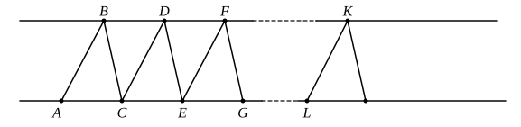

two angles $C''AB''$, $AB''C''$ is equal to the angle $C'AB'$ in the preceding triangle, and is therefore less than $\frac{1}{2}A$, and (3) the angle $C''AB'$ is less than half the angle $C'AB'$, and therefore less than $\frac{1}{4}A$.

Continuing in this way, we shall obtain a triangle $Abc$ such that the sum of two angles, those at $A$ and $b$, is less than $\frac{1}{2^n} A$, and the angle at $c$ is greater than the corresponding angle in the preceding triangle.

If, Legendre argues, the construction be continued indefinitely so that $\frac{1}{2^n} A$ becomes smaller than any assigned angle, the point $c$ ultimately lies on $Ab$, and the sum of the three angles of the triangle (which is equal to the sum of the three angles of the original triangle) becomes identical with the angle at $c$, which is then a *flat* angle, and therefore equal to two right angles.

This proof was however shown to be unsound (in respect of the final inference) by J. P. W. Stein in Gergonne's *Annales de Mathématiques* XV., 1824, pp. 77—79.

We will now reproduce shortly the substance of the theorems of Legendre which are of the most permanent value as not depending on a particular hypothesis as regards parallels.

I. *The sum of the three angles of a triangle cannot be greater than two right angles.*

This Legendre proved in two ways.

(1) *First proof* (in the third edition of the *Éléments*).

Let ">$ABC$ be the given triangle, and $ACJ$ a straight line.

Make $CE$ equal to $AC$, the angle $DCE$ equal to the angle $BAC$, and $DC$ equal to $AB$. Join $DE$.

Then the triangle ">$DCE$ is equal to the triangle ">$BAC$ in all respects.

If then the sum of the three angles of the triangle ">$ABC$ is greater than

$2R$, the said sum must be greater than the sum of the angles $BCA$, $BCD$, $DCE$, which sum is *equal* to $2R$.

Subtracting the equal angles on both sides, we have the result that

the angle $ABC$ is *greater* than the angle $BCD$.

But the two sides $AB$, $BC$ of the triangle ">$ABC$ are respectively equal to the two sides $DC$, $CB$ of the triangle ">$BCD$.

Therefore the base $AC$ is *greater* than the base $BD$ (Eucl. I. 24).

Next, make the triangle ">$FEG$ (by the same construction) equal in all respects to the triangle ">$BAC$ or ">$DCE$; and we prove in the same way that $CE$ (or $AC$) is *greater* than $DF$.

And, at the same time, $BD$ is equal to $DF$, because the angles $BCD$, $DEF$ are equal.

Continuing the construction of further triangles, however small the difference between $AC$ and $BD$ is, we shall ultimately reach some multiple
