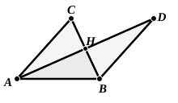
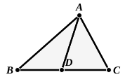

of this difference, represented in the figure by (say) the difference between the straight line $AJ$ and the composite line $BDFHK$, which will be greater than any assigned length, and greater therefore than the sum of $AB$ and $JK$.

Hence, on the assumption that the sum of the angles of the triangle ">$ABC$ is greater than $2R$, the broken line $ABDFHKJ$ may be less than the straight line $AJ$: which is impossible.

Therefore etc.

(2) *Proof substituted later.*

If possible, let $2R + \alpha$ be the sum of the three angles of the triangle ">$ABC$, of which $A$ is not greater than either of the others.

Bisect $BC$ at $H$, and produce $AH$ to $D$, making $HD$ equal to $AH$; join $BD$.

Then the triangles ">$AHC$, ">$DHB$ are equal in all respects (I. 4); and the angles $CAH$, $ACH$ are respectively equal to the angles $BDH$, $DBH$.

It follows that the sum of the angles of the triangle ">$ABD$ is equal to the sum of the angles of the original triangle, i.e. to $2R + \alpha$.

And one of the angles $DAB$, $ADB$ is either equal to or less than half the angle $CAB$.

Continuing the same construction with the triangle ">$ADB$, we find a third triangle in which the sum of the angles is still $2R + \alpha$, while one of them is equal to or less than $(\angle CAB)/4$.

Proceeding in this way, we arrive at a triangle in which the sum of the angles is $2R + \alpha$, and one of them is not greater than $(\angle CAB)/2^n$.

And, if $n$ is sufficiently large, this will be less than $\alpha$; in which case we should have a triangle in which two angles are together greater than two right angles: which is absurd.

Therefore $\alpha$ is equal to or less than zero.

(It will be noted that in both these proofs, as in Eucl. I. 16, it is taken for granted that *a straight line is infinite in length* and does not return into itself, which is not true under the Riemann hypothesis.)

II. On the assumption that the sum of the angles of a triangle is *less* than two right angles, *if a triangle is made up of two others, the "deficit" of the former is equal to the sum of the "deficits" of the others*.

In fact, if the sums of the angles of the component triangles are $2R - \alpha$, $2R - \beta$ respectively, the sum of the angles of the whole triangle is
$$(2R - \alpha) + (2R - \beta) - 2R = 2R - (\alpha + \beta).$$

III. *If the sum of the three angles of a triangle is equal to two right angles, the same is true of all triangles obtained by subdividing it by straight lines drawn from a vertex to meet the opposite side.*

Since the sum of the angles of the triangle ">$ABC$ is equal to $2R$, if the sum of the angles of the triangle ">$ABD$ were $2R - \alpha$, it would follow that the sum of the angles of the triangle ">$ADC$ must be $2R + \alpha$, which is absurd (by I. above).

IV. *If in a triangle the sum of the three angles is equal to two right angles, a quadrilateral can always be constructed with four right angles and four equal sides exceeding in length any assigned rectilineal segment.*

Let ">$ABC$ be a triangle in which the sum of the angles is equal to two
