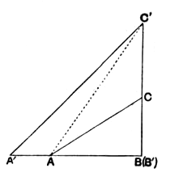

right angles. We can assume $ABC$ to be an *isosceles right-angled* triangle because we can reduce the case to this by making subdivisions of $ABC$ by straight lines through vertices (as in Prop. III. above).

Taking two equal triangles of this kind and placing their hypotenuses together, we obtain a quadrilateral with four right angles and four equal sides.

Putting four of these quadrilaterals together, we obtain a new quadrilateral of the same kind but with its sides double of those of the first quadrilateral.

After $n$ such operations we have a quadrilateral with four right angles and four equal sides, each being equal to $2^n$ times the side $AB$.

The diagonal of this quadrilateral divides it into two equal isosceles right-angled triangles in each of which the sum of the angles is equal to two right angles.

Consequently, from the existence of *one* triangle in which the sum of the three angles is equal to two right angles it follows that there exists an isosceles right-angled triangle with sides greater than any assigned rectilineal segment and such that the sum of its three angles is also equal to two right angles.

V. *If the sum of the three angles of* one *triangle is equal to two right angles, the sum of the three angles of* any other *triangle is also equal to two right angles.*

It is enough to prove this for a *right-angled* triangle, since any triangle can be divided into two right-angled triangles.

Let $ABC$ be any right-angled triangle.

If then the sum of the angles of any one triangle is equal to two right angles, we can construct (by the preceding Prop.) an isosceles right-angled triangle with the same property and with its perpendicular sides greater than those of $ABC$.

Let $A'B'C'$ be such a triangle, and let it be applied to $ABC$, as in the figure.

Applying then Prop. III. above, we deduce first that the sum of the three angles of the triangle $AB'C'$ is equal to two right angles, and next, for the same reason, that the sum of the three angles of the original triangle $ABC$ is equal to two right angles.

VI. *If in* any one *triangle the sum of the three angles is less than two right angles, the sum of the three angles of* any other *triangle is also less than two right angles.*

This follows from the preceding theorem.

(It will be observed that the last two theorems are included among those of Saccheri, which contain however in addition the corresponding theorem touching the case where the sum of the angles is *greater* than two right angles.)

We come now to the bearing of these propositions upon Euclid's Postulate 5; and the next theorem is

VII. *If the sum of the three angles of a triangle is equal to two right angles, through any point in a plane there can only be drawn one parallel to a given straight line.*
