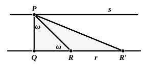

For the proof of this we require the following

LEMMA. *It is always possible, through a point $P$, to draw a straight line which shall make, with a given straight line ($r$), an angle less than any assigned angle.*

Let $Q$ be the foot of the perpendicular from $P$ upon $r$.

Let a segment $QR$ be taken on $r$, on either side of $Q$, such that $QR$ is equal to $PQ$.

Join $PR$, and mark off the segment $RR'$ equal to $PR$; join $PR'$.

If $\omega$ represents the angle $QPR$ or the angle $QRP$, each of the equal angles $RPR'$, $RR'P$ is not greater than $\omega/2$.

Continuing the construction, we obtain, after the requisite number of operations, a triangle $PR_{n-1}R_n$ in which each of the equal angles is equal to or less than $\omega/2^n$.

Hence we shall arrive at a straight line $PR_n$ which, starting from $P$ and meeting $r$, makes with $r$ an angle as small as we please.

To return now to the Proposition. Draw from $P$ the straight line $s$ perpendicular to $PQ$.

Then any straight line drawn from $P$ which meets $r$ in $R$ will form equal angles with $r$ and $s$, since, by hypothesis, the sum of the angles of the triangle ">$PQR$ is equal to two right angles.

And since, by the Lemma, it is always possible to draw through $P$ straight lines which form with $r$ angles as small as we please, it follows that all the straight lines through $P$, except $s$, will meet $r$. Hence $s$ is the only parallel to $r$ that can be drawn through $P$.

The history of the attempts to prove Postulate 5 or something equivalent has now been brought down to the parting of the ways. The further developments on lines independent of the Postulate, beginning with Schweikart (1780—1857), Taurinus (1794—1874), Gauss (1777—1855), Lobachewsky (1793—1856), J. Bolyai (1802—1860), Riemann (1826—1866), belong to the history of non-Euclidean geometry, which is outside the scope of this work. I may refer the reader to the full article *Sulla teoria delle parallele e sulle geometrie non-euclidee* by R. Bonola in *Questioni riguardanti le matematiche elementari*, I., of which I have made considerable use in the above, to the same author's *La geometria non-euclidea*, Bologna, 1906, to the first volume of Killing's *Einführung in die Grundlagen der Geometrie*, Paderborn, 1893, to P. Mansion's *Premiers principes de métagéométrie*, and P. Barbarin's *La géométrie non-Euclidienne*, Paris, 1902, to the historical summary in Veronese's *Fondamenti di geometria*, 1891, p. 565 sqq., and (for original sources) to Engel and Stäckel, *Die Theorie der Parallellinien von Euklid bis auf Gauss*, 1895, and *Urkunden zur Geschichte der nicht-Euklidischen Geometrie*, I. (Lobachewsky), 1899, and II. (Wolfgang und Johann Bolyai). I will only add that it was Gauss who first expressed a conviction that the Postulate could never be proved; he indicated this in reviews in the *Göttingische gelehrte Anzeigen*, 20 Apr. 1816 and 28 Oct. 1822, and affirmed it in a letter to Bessel of 27 January, 1829. The actual indemonstrability of the Postulate was proved by Beltrami (1868) and by Hoüel (*Note sur l'impossibilité de démontrer par une construction plane le principe de la théorie des parallèles dit Postulatum d'Euclide* in Battaglini's *Giornale di matematiche*, VIII., 1870, pp. 84—89).
