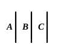

the geometers," goes on to say: "For in their view (that of Aristotle and the geometers) *axiom* and *common notion* are the same thing." This, as it seems to me, may be a sort of apology for using the word "axiom" exclusively in what has gone before, as if Proclus had suddenly bethought himself that he had described both Aristotle and the geometers as using the one term "axiom," whereas he should have said that Aristotle spoke of "axioms," while "the geometers" (in fact Euclid), though meaning the same thing, called them *Common Notions*. It may be for a like reason that in another passage (p. 76, 16), after quoting Aristotle's view of an "axiom," as distinct from a postulate and a hypothesis, he proceeds: "For it is not by virtue of a *common notion* that, without being taught, we preconceive the circle to be such and such a figure." If this view of the two passages just quoted is correct, it would strengthen rather than weaken the case for the genuineness of *Common Notions* as the Euclidean term.

Again, it is clear from Aristotle's allusions to the "common axioms in mathematics" that more than one axiom of this kind had a place in the text-books of his day; and as he constantly quotes the particular axiom that, *if equals be taken from equals, the remainders are equal*, which is Euclid's *Common Notion* 3, it would seem that at least the first three *Common Notions* were adopted by Euclid from earlier text-books. It is, besides, scarcely credible that, if the *Common Notions* which Apollonius tried to prove had not been introduced earlier (e.g. by Euclid), they would then have been interpolated as axioms and not as propositions to be proved. The line taken by Apollonius is much better explained on the assumption that he was directly attacking axioms which he found already admitted into the *Elements*.

Proclus, who recognised the five *Common Notions* given in the text, warns us, not only against the error of unnecessarily multiplying the axioms, but against the contrary error of reducing their number unduly (p. 196, 15), "as Heron does in enunciating three only; for it is also an axiom that *the whole is greater than the part*, and indeed the geometer employs this in many places for his demonstrations, and again that *things which coincide are equal*."

Thus Heron recognised the first three of the *Common Notions*; and this fact, together with Aristotle's allusions to "common axioms" (in the plural), and in particular to our *Common Notion* 3, may satisfy us that at least the first three *Common Notions* were contained in the *Elements* as they left Euclid's hands.

---

### COMMON NOTION 1.

**Τὰ τῷ αὐτῷ ἴσα καὶ ἀλλήλοις ἐστὶν ἴσα.**

*Things which are equal to the same thing are also equal to one another.*

Aristotle throughout emphasises the fact that axioms are self-evident truths, which it is impossible to demonstrate. If, he says, any one should attempt to prove them, it could only be through ignorance. Aristotle therefore would undoubtedly have agreed in Proclus' strictures on Apollonius for attempting to prove the axioms. Proclus gives (p. 194, 25), as a specimen of these attempted proofs by Apollonius, that of the first of the *Common Notions*. "Let $A$ be equal to $B$, and the latter to $C$; I say that $A$ is also equal to $C$. For, since $A$ is equal to $B$, it occupies the same space with it; and since $B$ is equal to $C$, it occupies the same space with it.

Therefore $A$ also occupies the same space with $C$."

Proclus rightly remarks (p. 194, 22) that "the middle term is no more
