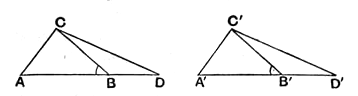
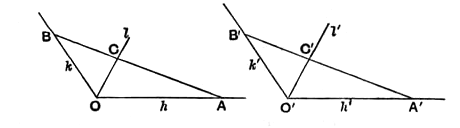

Then the two triangles $ABC$, $A'B'D$ have two sides and the included angles congruent respectively; therefore, by the same postulate, the angles $BAC$, $B'A'D$ are congruent.

But the angles $BAC$, $B'A'C'$ are congruent; therefore, by (4) above, the angles $B'A'C'$, $B'A'D$ are congruent: which is impossible, since it contradicts (8) above.

Hence $BC$, $B'C'$ cannot but be congruent.

Eucl. I. 4 is thus proved; but it seems to be as well to include all of that theorem in the postulate, as is done in (11) above, since the two parts of it are equally suggested by empirical observation of the result of one superposition.

A proof similar to that just given immediately establishes Eucl. I. 26 (1), and Hilbert next proves that

*If two angles $\text{ABC}$, $\text{A}'\text{B}'\text{C}'$ are congruent with one another, their supplementary angles $\text{CBD}$, $\text{C}'\text{B}'\text{D}'$ are also congruent with one another.*

We choose $A$, $D$ on one of the straight lines forming the first angle, and $A'$, $D'$ on one of those forming the second angle, and again $C$, $C'$ on the other

straight lines forming the angles, so that $A'B'$ is congruent with $AB$, $C'B'$ with $CB$, and $D'B'$ with $DB$.

The triangles $ABC$, $A'B'C'$ are congruent, by (11) above; and $AC$ is congruent with $A'C'$, and the angle $CAB$ with the angle $C'A'B'$.

Thus, $AD$, $A'D'$ being congruent, by (9), the triangles $CAD$, $C'A'D'$ are also congruent, by (11);

whence $CD$ is congruent with $C'D'$, and the angle $ADC$ with the angle $A'D'C'$.

Lastly, by (11), the triangles $CDB$, $C'D'B'$ are congruent, and the angles $CBD$, $C'B'D'$ are thus congruent.

Hilbert's next proposition is that

*Given that the angle $(\text{h}, \text{k})$ in the plane $\alpha$ is congruent with the angle $(\text{h}', \text{k}')$ in the plane $\alpha'$, and that $\text{l}$ is a half-ray in the plane $\alpha$ starting from the vertex of the angle $(\text{h}, \text{k})$ and lying within that angle, there always exists a half-ray $\text{l}'$ in the second plane $\alpha'$, starting from the vertex of the angle $(\text{h}', \text{k}')$ and lying within that angle, such that*
$$(\text{h}, \text{l}) \equiv (\text{h}', \text{l}'), \text{ and } (\text{k}, \text{l}) \equiv (\text{k}', \text{l}').$$

If $O$, $O'$ are the vertices, we choose points $A$, $B$ on $h$, $k$, and points $A'$, $B'$ on $h'$, $k'$ respectively, such that $OA$, $O'A'$ are congruent and also $OB$, $O'B'$.

The triangles $OAB$, $O'A'B'$ are then congruent; and, if $l$ meets $AB$ in $C$, we can determine $C'$ on $A'B'$ such that $A'C'$ is congruent with $AC$.

Then $l'$ drawn from $O'$ through $C'$ is the half-ray required.
