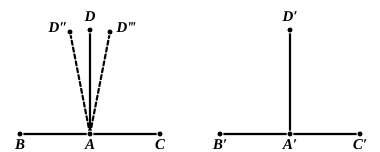

The congruence of the angles $(h, l)$, $(h', l')$ follows from (11) directly, and that of $(k, l)$ and $(k', l')$ follows in the same way after we have inferred by means of (9) that, $AB$, $AC$ being respectively congruent with $A'B'$, $A'C'$, the difference $BC$ is congruent with the difference $B'C'$.

It is by means of the two propositions just given that Hilbert proves that

*All right angles are congruent with one another.*

Let the angle $BAD$ be congruent with its adjacent angle $CAD$, and likewise the angle $B'A'D'$ congruent with its adjacent angle $C'A'D'$. All four angles are then right angles.

If the angle $B'A'D'$ is not congruent with the angle $BAD$, let the angle with $AB$ for one side and congruent with the angle $B'A'D'$ be the angle $BAD''$, so that $AD''$ falls either within the angle $BAD$ or within the angle $DAC$. Suppose the former.

By the last proposition but one (about adjacent angles), the angles $B'A'D'$, $BAD''$ being congruent, the angles $C'A'D'$, $CAD''$ are congruent.

Hence, by the hypothesis and postulate (4) above, the angles $BAD''$, $CAD''$ are also congruent.

And, since the angles $BAD$, $CAD$ are congruent, we can find within the angle $CAD$ a half-ray $CAD'''$ such that the angles $BAD''$, $CAD'''$ are congruent, and likewise the angles $DAD''$, $DAD'''$ (by the last proposition).

But the angles $BAD''$, $CAD''$ were congruent (see above); and it follows, by (4), that the angles $CAD''$, $CAD'''$ are congruent: which is impossible, since it contradicts postulate (8).

Therefore etc.

Euclid I. 5 follows directly by applying the postulate (11) above to $ABC$, $ACB$ as distinct triangles.

Postulates (9), (10) above give in substance the proposition that "the sums or differences of segments, or of angles, respectively equal, are equal."

Lastly, Hilbert proves Eucl. I. 8 by means of the theorem of Eucl. I. 5 and the proposition just stated as applied to angles.

">$ABC$, ">$A'B'C'$ being the given triangles with three sides respectively congruent, we suppose an angle $CBA''$ to be determined, on the side of $BC$ opposite to $A$, congruent with the angle $A'B'C'$, and we make $BA''$ equal to $A'B'$.

The proof is obvious, being equivalent to the alternative proof often given in our text-books for Eucl. I. 8.
