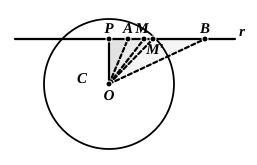

Thus exactly the same thing holds of $c$, the ray corresponding to $C$, with reference to the division of the angle $(ab)$ into two parts.

It is not difficult to extend this to an angle $(ab)$ which is either *flat* or greater than two right angles; this is done (Vitali, *op. cit.* pp. 126—127) by supposing the angle to be divided into two, $(ad)$, $(db)$, each less than two right angles, and considering the three cases in which

(1) the ray $d$ is such that all the rays that precede it belong to the first part and those which follow it to the second part,
(2) the ray $d$ is followed by some rays of the first part,
(3) the ray $d$ is preceded by some rays of the second part.

#### *Application to circular arcs.*

If we consider an arc $AB$ of a circle with centre $O$, the points of the arc correspond univocally, and in the same order, to the rays from the point $O$ passing through those points respectively, and the same argument by which we passed from a segment of a straight line to an angle can be used to make the transition from an angle to an arc.

### Intersections of a straight line with a circle.

It is possible to use the Postulate of Dedekind to prove that

*If a straight line has one point inside and one point outside a circle, it has two points common with the circle.*

For this purpose it is necessary to assume (1) the proposition with reference to the perpendicular and obliques drawn from a given point to a given straight line, namely that of all straight lines drawn from a given point to a given straight line the perpendicular is the shortest, and of the rest (the obliques) that is the longer which has the longer projection upon the straight line, while those are equal the projections of which are equal, so that for any given length of projection there are two equal obliques and two only, one on each side of the perpendicular, and (2) the proposition that any side of a triangle is less than the sum of the other two.

Consider the circle $(C)$ with centre $O$, and a straight line $(r)$ with one point $A$ inside and one point $B$ outside the circle.

By the definition of the circle, if $R$ is the radius,

$$OA < R, \quad OB > R.$$

Draw $OP$ perpendicular to the straight line $r$.

Then $OP$ < $OA$, so that $OP$ is always less than $R$, and $P$ is therefore within the circle $C$.

Now let us fix our attention on the finite segment $AB$ of the straight line $r$. It can be divided into two parts, (1) that containing all the points $H$ for which $OH < R$ (i.e. points inside $C$), and (2) that containing all the points $K$ for which $OK \geqq R$ (points outside $C$ or on the circumference of $C$).

Thus, remembering that, of two obliques from a given point to a given straight line, that is greater the projection of which is greater, we can assert that all the points of the segment $PB$ which *precede* a point inside $C$ are inside $C$, and those which *follow* a point on the circumference of $C$ or outside $C$ are outside $C$.

Hence, by the Postulate of Dedekind, there exists on the segment $PB$ a
