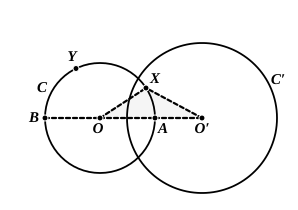

point $M$ such that all the points which precede it belong to the first part and those which follow it to the second part.

I say that $M$ is common to the straight line $r$ and the circle $C$, or

$$OM = R.$$

For suppose, e.g., that $OM < R$.

There will then exist a segment (or length) $\sigma$ less than the difference between $R$ and $OM$.

Consider the point $M'$, one of those which *follow* $M$, such that $MM'$ is equal to $\sigma$.

Then, because any side of a triangle is less than the sum of the other two,

$$OM' < OM + MM'.$$

But

$$OM + MM' = OM + \sigma < R,$$

whence

$$OM' < R,$$

which is absurd.

A similar absurdity would follow if we suppose that $OM > R$.

Therefore $OM$ must be equal to $R$.

It is immediately obvious that, corresponding to the point $M$ on the segment $PB$ which is common to $r$ and $C$, there is another point on $r$ which has the same property, namely that which is symmetrical to $M$ with respect to $P$.

And the proposition is proved.

### Intersections of two circles.

We can likewise use the Postulate of Dedekind to prove that

*If in a given plane a circle* $C$ *has one point* $X$ *inside and one point* $Y$ *outside another circle* $C'$, *the two circles intersect in two points.*

We must first prove the following

#### *Lemma.*

If $O$, $O'$ are the centres of two circles $C$, $C'$, and $R$, $R'$ their radii respectively, the straight line $OO'$ meets the circle $C$ in two points $A$, $B$, one of which is inside $C'$ and the other outside it.

Now one of these points must fall (1) on the prolongation of $O'O$ beyond $O$ or (2) on $OO'$ itself or (3) on the prolongation of $OO'$ beyond $O'$.

(1) First, suppose $A$ to lie on $O'O$ produced.

Then

$$AO' = AO + OO' = R + OO' \ldots\ldots (\alpha).$$

But, in the triangle $OO'Y$,

$$O'Y < OY + OO',$$

and, since $O'Y > R'$, $OY = R$,

$$R' < R + OO'.$$

It follows from $(\alpha)$ that $AO' > R'$; and $A$ therefore lies *outside* $C'$.

(2) Secondly, suppose $A$ to lie on $OO'$.

Then

$$OO' = OA + AO' = R + AO' \ldots (\beta).$$

From the triangle $OO'X$ we have

$$OO' < OX + O'X,$$

and, since $OX = R$, $O'X < R'$, it follows that

$$OO' < R + R',$$

whence, by $(\beta)$, $AO' < R'$, so that $A$ lies *inside* $C'$.
