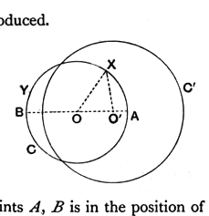
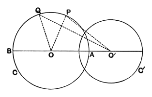

(3) Thirdly, suppose $A$ to lie on $OO'$ produced.

Then

$$R = OA = OO' + O'A \ldots\ldots\ldots (\gamma).$$

And, in the triangle $OO'X$,

$$OX < OO' + O'X,$$

that is

$$R < OO' + O'X,$$

whence, by $(\gamma)$,

$$OO' + O'A < OO' + O'X,$$

or

$$O'A < O'X,$$

and $A$ lies *inside* $C'$.

It is to be observed that one of the two points $A$, $B$ is in the position of case (1) and the other in the position of either case (2) or case (3): whence we must conclude that one of the two points $A$, $B$ is *inside* and the other *outside* the circle $C'$.

#### *Proof of theorem.*

The circle $C$ is divided by the points $A$, $B$ into two semicircles. Consider one of them, and suppose it to be described by a point moving from $A$ to $B$.

Take two separate points $P$, $Q$ on it and, to fix our ideas, suppose that $P$ precedes $Q$.

Comparing the triangles $OO'P$, $OO'Q$, we observe that one side $OO'$ is common, $OP$ is equal to $OQ$, and the angle $POO'$ is less than the angle $QOO'$.

Therefore $O'P < O'Q$.

Now, considering the semicircle $APQB$ as divided into two parts, so that the points of the first part are inside the circle $C'$, and those of the second part on the circumference of $C'$ or outside it, we have the conditions necessary for the applicability of the Postulate of Dedekind (which is true for arcs of circles as for straight lines); whence *there exists a point* $M$ *separating the two parts.*

I say that $O'M = R'$.

For, if not, suppose $O'M < R'$.

If then $\sigma$ signifies the difference between $R'$ and $O'M$, suppose a point $M'$, which *follows* $M$, taken on the semicircle such that the chord $MM'$ is not greater than $\sigma$ (for a way of doing this see below).

Then, in the triangle $O'MM'$,

$$O'M' < O'M + MM' < O'M + \sigma,$$

and therefore

$$O'M' < R'.$$

It follows that $M'$, a point on the arc $MB$, is inside the circle $C'$: which is absurd.

Similarly it may be proved that $O'M$ is not greater than $R$.

Hence $O'M = R$.

[To find a point $M'$ such that the chord $MM'$ is not greater than $\sigma$, we may proceed thus.

Draw from $M$ a straight line $MP$ distinct from $OM$, and cut off $MP$ on it equal to $\sigma/2$.
