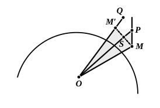

Join $OP$, and draw another radius $OQ$ such that the angle $POQ$ is equal to the angle $MOP$.

The intersection, $M'$, of $OQ$ with the circle satisfies the required condition.

For $MM'$ meets $OP$ at right angles in $S$.

Therefore, in the right-angled triangle ">$MSP$, $MS$ is not greater than $MP$ (it is less, unless $MP$ coincides with $MS$, when it is equal).

Therefore $MS$ is not greater than $\sigma/2$, so that $MM'$ is not greater than $\sigma$.]
