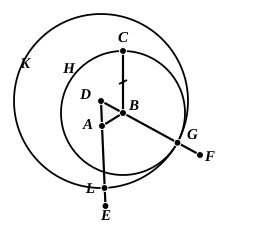

### PROPOSITION 2.

To place at a given point (as an extremity) a straight line equal to a given straight line.

Let $A$ be the given point, and $BC$ the given straight line.

Thus it is required to place at the point $A$ (as an extremity) a straight line equal to the given straight line $BC$.

From the point $A$ to the point $B$ let the straight line $AB$ be joined; [Post. 1]  
and on it let the equilateral triangle $DAB$ be constructed. [I. 1]

Let the straight lines $AE$, $BF$ be produced in a straight line with $DA$, $DB$; [Post. 2]  
with centre $B$ and distance $BC$ let the circle $CGH$ be described; [Post. 3]  
and again, with centre $D$ and distance $DG$ let the circle $GKL$ be described. [Post. 3]

Then, since the point $B$ is the centre of the circle $CGH$,

$BC$ is equal to $BG$.

20 Again, since the point $D$ is the centre of the circle $GKL$,

$DL$ is equal to $DG$.

And in these $DA$ is equal to $DB$;  
therefore the remainder $AL$ is equal to the remainder $BG$. [C.N. 3]

25 But $BC$ was also proved equal to $BG$;  
therefore each of the straight lines $AL$, $BC$ is equal to $BG$.

And things which are equal to the same thing are also equal to one another; [C.N. 1]

30 therefore $AL$ is also equal to $BC$.

Therefore at the given point $A$ the straight line $AL$ is placed equal to the given straight line $BC$.

(Being) what it was required to do.

---

**1. (as an extremity).** I have inserted these words because “to place a straight line at a given point” (πρὸς τῷ δοθέντι σημείῳ) is not quite clear enough, at least in English.

**11. Let the straight lines AE, BF be produced....** It will be observed that in this first application of Postulate 2, and again in I. 5, Euclid speaks of the *continuation* of the straight line as that which is produced in such cases, ἐκβεβλήσθωσαν and προσεκβεβλήσθωσαν meaning little more than *drawing* straight lines “in a straight line with” the given straight lines. The first place in which Euclid uses phraseology exactly corresponding to ours when
