### PROPOSITION 5.

In isosceles triangles the angles at the base are equal to one another, and, if the equal straight lines be produced further, the angles under the base will be equal to one another.

Let ">$ABC$ be an isosceles triangle having the side $AB$  
5 equal to the side $AC$;  
and let the straight lines $BD$, $CE$ be produced further in a straight line with $AB$, $AC$. [Post. 2]

I say that the angle $ABC$ is equal to the angle $ACB$, and the angle $CBD$ to the angle $BCE$.

10 Let a point $F$ be taken at random on $BD$;  
from $AE$ the greater let $AG$ be cut off equal to $AF$ the less; [I. 3]  
and let the straight lines $FC$, $GB$ be joined. [Post. 1]

15 Then, since $AF$ is equal to $AG$ and $AB$ to $AC$,  

the two sides $FA$, $AC$ are equal to the two sides $GA$, $AB$, respectively;

and they contain a common angle, the angle $FAG$.

20 Therefore the base $FC$ is equal to the base $GB$,

and the triangle ">$AFC$ is equal to the triangle ">$AGB$,  
and the remaining angles will be equal to the remaining angles respectively, namely those which the equal sides subtend,  

that is, the angle $ACF$ to the angle $ABG$,

[I. 4]25 and the angle $AFC$ to the angle $AGB$.

And, since the whole $AF$ is equal to the whole $AG$,  
and in these $AB$ is equal to $AC$,

the remainder $BF$ is equal to the remainder $CG$.

But $FC$ was also proved equal to $GB$;  
30 therefore the two sides $BF$, $FC$ are equal to the two sides $CG$, $GB$ respectively;  
and the angle $BFC$ is equal to the angle $CGB$,  

while the base $BC$ is common to them;

therefore the triangle ">$BFC$ is also equal to the triangle ">$CGB$,  
35 and the remaining angles will be equal to the remaining
