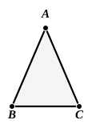

I. 5 was his own, and it would thus appear that his innovations as regards order of propositions and methods of proof began at the very threshold of the subject.

### Proof without producing the sides.

In this proof, given by Proclus (pp. 248, 22—249, 19), $D$ and $E$ are taken on $AB$, $AC$, instead of on $AB$, $AC$ *produced*, so that $AD$, $AE$ are equal. The method of proof is of course exactly like Euclid's, but it does not establish the equality of the angles beyond the base as well.

### Pappus' proof.

Proclus (pp. 249, 20—250, 12) says that Pappus proved the theorem in a still shorter manner without the help of any construction whatever.

This very interesting proof is given as follows:

“Let $ABC$ be an isosceles triangle, and $AB$ equal to $AC$.

Let us conceive this one triangle as two triangles, and let us argue in this way.

Since $AB$ is equal to $AC$, and $AC$ to $AB$,  
the two sides $AB$, $AC$ are equal to the two sides $AC$, $AB$.

And the angle $BAC$ is equal to the angle $CAB$, for it is the same.

Therefore all the corresponding parts (in the triangles) are equal, namely  
$BC$ to $BC$,  
the triangle $ABC$ to the triangle $ABC$ (i.e. $ACB$),  
the angle $ABC$ to the angle $ACB$,  
and the angle $ACB$ to the angle $ABC$,  
(for these are the angles subtended by the equal sides $AB$, $AC$.

Therefore in isosceles triangles the angles at the base are equal.”

This will no doubt be recognised as the foundation of the alternative proof frequently given by modern editors, though they do not refer to Pappus. But they state the proof in a different form, the common method being to suppose the triangle to be taken up, turned over, and placed again upon *itself*, after which the same considerations of congruence as those used by Euclid in I. 4 are used over again. There is the obvious difficulty that it supposes the triangle to be taken up and at the same time to remain where it is. (Cf. Dodgson's humorous remark upon this, *Euclid and his modern Rivals*, p. 47.) Whatever we may say in justification of the proceeding (e.g. that the triangle may be supposed to leave a *trace*), it is really equivalent to assuming the construction (hypothetical, if you will) of another triangle equal in all respects to the given triangle; and such an assumption is not in accordance with Euclid's principles and practice.

It seems to me that the form given to the proof by Pappus himself is by far the best, for the reasons (1) that it assumes no construction of a second triangle, real or hypothetical, (2) that it avoids the distinct awkwardness involved by a proof which, instead of merely quoting and applying the *result* of a previous proposition, repeats, with reference to a new set of data, the *process* by which that result was established. If it is asked how we are to realise Pappus' idea of *two* triangles, surely we may answer that we keep to one triangle and merely view it in two aspects. If it were a question of helping a beginner to understand this, we might say that one triangle is the triangle
