looked at in front and that the other triangle is the *same* triangle looked at from *behind*; but even this is not really necessary.

Pappus' proof, of course, does not include the proof of the second part of the proposition about the angles under the base, and we should still have to establish this much in the same way as Euclid does.

### Purpose of the second part of the theorem.

An interesting question arises as to the reason for Euclid's insertion of the second part, to which, it will be observed, the converse proposition I. 6 has nothing corresponding. As a matter of fact, it is not necessary for any subsequent demonstration that is to be found in the original text of Euclid, but only for the interpolated second case of I. 7; and it was perhaps not unnatural that the undoubted genuineness of the second part of I. 5 convinced many editors that the second case of I. 7 must necessarily be Euclid's also. Proclus' explanation, which must apparently be the right one, is that the second part of I. 5 was inserted for the purpose of fore-arming the learner against a possible objection (ἔνστασις), as it was technically called, which might be raised to I. 7 as given in the text, with one case only. The *objection* would, as we have seen, take the specific ground that, as demonstrated, the theorem was not conclusive, since it did not cover all possible cases. From this point of view, the second part of I. 5 is useful not only for I. 7 but, according to Proclus, for I. 9 also. Simson does not seem to have grasped Proclus' meaning, for he says: “And Proclus acknowledges, that the second part of Prop. 5 was added upon account of Prop. 7 but gives a ridiculous reason for it, ‘that it might afford an answer to objections made against the 7th,’ as if the case of the 7th which is left out were, as he expressly makes it, an objection against the proposition itself.”

---

### PROPOSITION 6.

If in a triangle two angles be equal to one another, the sides which subtend the equal angles will also be equal to one another.

Let ">$ABC$ be a triangle having the angle $ABC$ equal to the angle $ACB$;  
I say that the side $AB$ is also equal to the side $AC$.

For, if $AB$ is unequal to $AC$, one of them is greater.

Let $AB$ be greater; and from $AB$ the greater let $DB$ be cut off equal to $AC$ the less;  
let $DC$ be joined.

Then, since $DB$ is equal to $AC$, and $BC$ is common,  

the two sides $DB$, $BC$ are equal to the two sides $AC$, $CB$ respectively;

