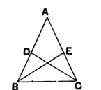
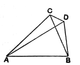

Then we have, in the two triangles $HFC$, $AGB$,  
two sides $HF$, $FC$ equal to two sides $AG$, $GB$  
and the angle $HFC$ equal to the angle $AGB$.

Therefore (I. 4) the triangles $HFC$, $AGB$ are equal. But the triangles $BFC$, $CGB$ are also equal.

Therefore (if we take away these equals respectively) the triangles $HBC$, $ACB$ are equal: which is impossible.

Therefore $AF$, $AG$ are not unequal.

Hence $AF$ is equal to $AG$ and, if we subtract the equals $BF$, $CG$ respectively, $AB$ is equal to $AC$.

This proof is found in the commentary of an-Nairīzī (ed. Besthorn-Heiberg, p. 61; ed. Curtze, p. 50).

### Alternative proofs of I. 6.

Todhunter points out that I. 6, not being wanted till II. 4, could be postponed till later and proved by means of I. 26. Bisect the angle $BAC$ by a straight line meeting the base at $D$. Then the triangles $ABD$, $ACD$ are equal in all respects.

Another method depending on I. 26 is given by an-Nairīzī after that proposition.

Measure equal lengths $BD$, $CE$ along the sides $BA$, $CA$.  
Join $BE$, $CD$.  
Then [I. 4] the triangles $DBC$, $ECB$ are equal in all respects;  
therefore $EB$, $DC$ are equal, and the angles $BEC$, $CDB$ are equal.

The supplements of the latter angles are equal [I. 13], and hence the triangles $ABE$, $ACD$ have two angles equal respectively and the side $BE$ equal to the side $CD$.

Therefore [I. 26] $AB$ is equal to $AC$.

### PROPOSITION 7.

#### *Given two straight lines constructed on a straight line (from its extremities) and meeting in a point, there cannot be constructed on the same straight line (from its extremities), and on the same side of it, two other straight lines meeting in 5another point and equal to the former two respectively, namely each to that which has the same extremity with it.*

For, if possible, given two straight lines $AC$, $CB$ constructed on the straight line $AB$ and meeting at the point $C$,  
let two other straight lines 10$AD$, $DB$ be constructed on the same straight line $AB$, on the same side of it, meeting in another point $D$ and equal to the former two respectively, namely each to that which has the same extremity with it,  
so that $CA$ is 15equal to $DA$ which has the same extremity $A$ with it, and
