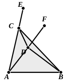

to relate his trifles at full length,” to which Taylor retorts “But Mr Simson was no philosopher; and therefore the greatest part of these Commentaries must be considered by him as trifles, from the want of a philosophic genius to comprehend their meaning, and a taste superior to that of a mere mathematician, to discover their beauty and elegance.”

**20.** It would be natural to insert here the step “but the angle $ACD$ is greater than the angle $BCD$. [C. N. 5.]”

**21. much greater,** literally “greater by much” (πολλῷ μείζων). Simson and those who follow him translate: “much more then is the angle $BDC$ greater than the angle $BCD$,” but the Greek for this would have to be πολλῷ (or πολὺ) μᾶλλόν ἐστι...μείζων. πολλῷ μᾶλλον, however, though used by Apollonius, is not, apparently, found in Euclid or Archimedes.

Just as in I. 6 we need a Postulate to justify theoretically the statement that $CD$ falls within the angle $ACB$, so that the triangle $DBC$ is less than the triangle $ABC$, so here we need Postulates which shall satisfy us as to the relative positions of $CA$, $CB$, $CD$ on the one hand and of $DC$, $DA$, $DB$ on the other, in order that we may be able to infer that the angle $BDC$ is greater than the angle $ADC$, and the angle $ACD$ greater than the angle $BCD$.

De Morgan (*op. cit.* p. 7) observes that I. 7 would be made easy to beginners if they were first familiarised, as a common notion, with “if two magnitudes be equal, any magnitude greater than the one is greater than any magnitude less than the other.” I doubt however whether a beginner would follow this easily; perhaps it would be more easily apprehended in the form “if any magnitude $A$ is greater than a magnitude $B$, the magnitude $A$ is greater than any magnitude equal to $B$, and (*a fortiori*) greater than any magnitude less than $B$.”

It has been mentioned already (note on I. 5) that the second case of I. 7 given by Simson and in our text-books generally is not in the original text (the omission being in accordance with Euclid’s general practice of giving only one case, and that the most difficult, and leaving the others to be worked out by the reader for himself). The second case is given by Proclus as the answer to a possible objection to Euclid’s proposition, which should assert that the proposition is not proved to be universally true, since the proof given does not cover all possible cases. Here the objector is supposed to contend that what Euclid declares to be impossible may still be possible if one pair of lines lie wholly within the other pair of lines; and the second part of I. 5 enables the objection to be refuted.

If possible, let $AD$, $DB$ be entirely within the triangle formed by $AC$, $CB$ with $AB$, and let $AC$ be equal to $AD$ and $BC$ to $BD$.

Join $CD$, and produce $AC$, $AD$ to $E$ and $F$.  
Then, since $AC$ is equal to $AD$,  
the triangle $ACD$ is isosceles,  
and the angles $ECD$, $FDC$ under the base are equal.  
But the angle $ECD$ is greater than the angle $BCD$,  
therefore the angle $FDC$ is also greater than the angle $BCD$.  
Therefore the angle $BDC$ is greater by far than the angle $BCD$.

Again, since $DB$ is equal to $CB$,  
the angles at the base of the triangle $BDC$ are equal, [I. 5]  
that is, the angle $BDC$ is equal to the angle $BCD$.

Therefore the same angle $BDC$ is both greater than and equal to the angle $BCD$: which is impossible.

The case in which $D$ falls on $AC$ or $BC$ does not require proof.
