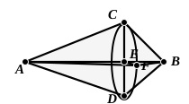
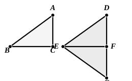

*Elements*.” I do not, however, think that this inference from Aristotle’s language as to the form of the pre-Euclidean proposition is safe. Thus if we, nowadays, were arguing from the data in the passage of Aristotle, we should doubtless infer directly that the triangles are equal in all respects, quoting I. 8 alone. Besides, Aristotle’s language is rather careless, as the next sentences of the same passage show. “Let perpendiculars,” he says, “be drawn to $AEB$ from the angles, $CE$ from $C$, $FE$ from $F$ and $DE$ from $D$. These, then, are equal; for they are all in equal triangles, and in one plane; for all of them are perpendicular to $AEB$, and they meet at one point $E$. Therefore the (line) drawn (through $C$, $F$, $D$) will be a circle, and its centre (will be) $E$.” Aristotle should obviously have proved that the three perpendiculars *will* meet at one point $E$ on $AEB$ before he spoke of drawing the perpendiculars $CE$, $FE$, $DE$. This of course follows from their being “in equal triangles” (by means of Eucl. I. 26); and then, from the fact that the perpendiculars meet at one point on $AB$, it can be inferred that all three are in one plane.

### Philo's proof of I. 8.

This alternative proof avoids the use of I. 7, and it is elegant; but it is inconvenient in one respect, since three cases have to be distinguished. Proclus gives the proof in the following order (pp. 266, 15—268, 14).

Let ">$ABC$, ">$DEF$ be two triangles having the sides $AB$, $AC$ equal to the sides $DE$, $DF$ respectively, and the base $BC$ equal to the base $EF$.

Let the triangle ">$ABC$ be applied to the triangle ">$DEF$, so that $B$ is placed on $E$ and $BC$ on $EF$, but so that $A$ falls on the opposite side of $EF$ from $D$, taking the position $G$. Then $C$ will coincide with $F$, since $BC$ is equal to $EF$.

Now $FG$ will either be in a straight line with $DF$, or make an angle with it, and in the latter case the angle will either be *interior* (κατὰ τὸ ἐντός) to the figure or *exterior* (κατὰ τὸ ἐκτός).

I. Let $FG$ be in a straight line with $DF$.  
Then, since $DE$ is equal to $EG$, and $DFG$ is a straight line,  
">$DEG$ is an isosceles triangle, and the angle at $D$ is equal to the angle at $G$.  
[I. 5].

II. Let $DF$, $FG$ form an angle *interior* to the figure.  
Let $DG$ be joined.  
Then, since $DE$, $EG$ are equal,  
the angle $EDG$ is equal to the angle $EGD$.  
Again, since $DF$ is equal to $FG$,  
the angle $FDG$ is equal to the angle $FGD$.  
Therefore, by addition,  
the whole angle $EDF$ is equal to the whole angle $EGF$.
