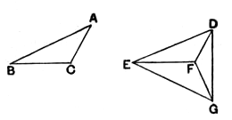
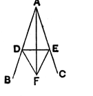

III. Let $DF$, $FG$ form an angle *exterior* to the figure.  
Let $DG$ be joined.  
The proof proceeds as in the last case, except that subtraction takes the place of addition, and  
the remaining angle $EDF$ is equal to the remaining angle $EGF$.

Therefore in all three cases the angle $EDF$ is equal to the angle $EGF$, that is, to the angle $BAC$.

It will be observed that, in accordance with the practice of the Greek geometers in not recognising as an “angle” any angle not less than two right angles, the re-entrant angle of the quadrilateral $DEGF$ is ignored and the angle $DFG$ is said to be *outside* the figure.

### PROPOSITION 9.

#### *To bisect a given rectilineal angle.*

Let the angle $BAC$ be the given rectilineal angle.  
Thus it is required to bisect it.  
Let a point $D$ be taken at random on $AB$;  
let $AE$ be cut off from $AC$ equal to $AD$; [I. 3]  
5 let $DE$ be joined, and on $DE$ let the equilateral triangle $DEF$ be constructed;  
let $AF$ be joined.

I say that the angle $BAC$ has been bisected by the straight line $AF$.

10 For, since $AD$ is equal to $AE$,  
and $AF$ is common,  
the two sides $DA$, $AF$ are equal to the two sides $EA$, $AF$ respectively.  
And the base $DF$ is equal to the base $EF$;  
15 therefore the angle $DAF$ is equal to the angle $EAF$. [I. 8]

Therefore the given rectilineal angle $BAC$ has been bisected by the straight line $AF$.

Q. E. F.

---

It will be observed from the translation of this proposition that Euclid does not say, in his description of the construction, that the equilateral triangle should be constructed on the side of $DE$ opposite to $A$; he leaves this to be inferred from his figure. There is no particular value in Proclus’ explanation as to how we should proceed in case any one should assert that he could not recognise the existence of any space below $DE$. He supposes, then, the equilateral triangle described on the side of $DE$ towards $A$, and hence has to consider three cases according as the vertex of the equilateral triangle falls on $A$, above $A$ or below it. The second and third cases do not differ
