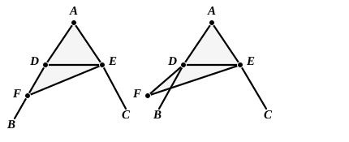

substantially from Euclid’s. In the first case, where ">$ADE$ is the equilateral triangle constructed on $DE$, take any point $F$ on $AD$, and from $AE$ cut off $AG$ equal to $AF$. Join $DG$, $EF$ meeting in $H$; and join $AH$. Then $AH$ is the bisector required.

Proclus also answers the possible objection that might be raised to Euclid’s proof on the ground that it assumes that, if the equilateral triangle be described on the side of $DE$ opposite to $A$, its vertex $F$ will lie within the angle $BAC$. The objector is supposed to argue that this is not necessary, but that $F$ might fall either on one of the lines forming the angle or outside it altogether. The two cases are disposed of thus.

Suppose $F$ to fall as shown in the two figures below respectively.

Then, since $FD$ is equal to $FE$,  
the angle $FDE$ is equal to the angle $FED$.  
Therefore the angle $CED$ is greater than the angle $FDE$; and, in the second figure, *a fortiori*, the angle $CED$ is greater than the angle $BDE$.  
But, since ">$ADE$ is an isosceles triangle, and the equal sides are produced,  
the angles under the base are equal,  
i.e., the angle $CED$ is equal to the angle $BDE$.  
But the angle $CED$ was proved greater: which is impossible.

Here then is the second case in which, in Proclus’ view, the second part of I. 5 is useful for refuting objections.

On this proposition Proclus takes occasion (p. 271, 15—19) to emphasize the fact that the given angle must be *rectilineal*, since the bisection of any sort of angle (including angles made by curves with one another or with straight lines) is not matter for an elementary treatise, besides which it is questionable whether such bisection is always possible. “Thus it is difficult to say whether it is possible to bisect the so-called *horn-like angle*” (formed by the circumference of a circle and a tangent to it).

### Trisection of an angle.

Further it is here that Proclus gives us his valuable historical note about the *trisection* of any acute angle, which (as well as the division of an angle in any given ratio) requires resort to other curves than circles, i.e. curves of the species which, after Geminus, he calls “mixed.” “This,” he says (p. 272, 1—12), “is shown by those who have set themselves the task of trisecting such a given rectilineal angle. For Nicomedes trisected any rectilineal angle by means of the *conchoidal* lines, the origin, order, and properties of which he has handed down to us, being himself the discoverer of their peculiarity. Others have done the same thing by means of the *quadratrices* of Hippias and Nicomedes, thereby again using ‘mixed’ curves. But others, starting from the Archimedean spirals, cut a given rectilineal angle in a given ratio.”
