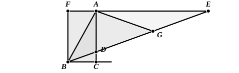
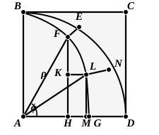

#### (a) Trisection by means of the conchoid.

I have already spoken of the conchoid of Nicomedes (note on Def. 2, pp. 160—1); it remains to show how it could be used for trisecting an angle. Pappus explains this (iv. pp. 274—5) as follows.

Let $ABC$ be the given acute angle, and from any point $A$ in $AB$ draw $AC$ perpendicular to $BC$.

Complete the parallelogram $FBCA$ and produce $FA$ to a point $E$ such that, if $BE$ be joined, $BE$ intercepts between $AC$ and $AE$ a length $DE$ equal to twice $AB$.

I say that the angle $EBC$ is one-third of the angle $ABC$.

For, joining $A$ to $G$, the middle point of $DE$, we have the three straight lines $AG$, $DG$, $EG$ equal, and the angle $AGD$ is double of the angle $AED$ or $EBC$.

But $DE$ is double of $AB$;  
therefore $AG$, which is equal to $DG$, is equal to $AB$.  
Hence the angle $AGD$ is equal to the angle $ABG$.  
Therefore the angle $ABD$ is also double of the angle $EBC$;  
so that the angle $EBC$ is one-third of the angle $ABC$.

So far Pappus, who reduces the construction to the drawing of $BE$ so that $DE$ shall be equal to twice $AB$.

This is what the conchoid constructed with $B$ as *pole*, $AC$ as *directrix*, and *distance* equal to twice $AB$ enables us to do; for that conchoid cuts $AE$ in the required point $E$.

#### (b) Use of the quadratrix.

The plural *quadratrices* in the above passage is a Hellenism for the singular *quadratrix*, which was a curve discovered by Hippias of Elis about 420 B.C. According to Proclus (p. 356, 11) Hippias proved its properties; and we are told (1) in the passage quoted above that Nicomedes also investigated it and that it was used for trisecting an angle, and (2) by Pappus (iv. pp. 250, 33—252, 4) that it was used by Dinostratus and Nicomedes and some more recent writers for squaring the circle, whence its name. It is described thus (Pappus iv. p. 252).

Suppose that $ABCD$ is a square and $BED$ a quadrant of a circle with centre $A$.

Suppose (1) that a radius of the circle moves uniformly about $A$ from the position $AB$ to the position $AD$, and (2) that *in the same time* the line $BC$ moves uniformly, always parallel to itself, and with its extremity $B$ moving along $BA$, from the position $BC$ to the position $AD$.

Then the radius $AE$ and the moving line $BC$ determine at any instant by their intersection a point $F$.

The locus of $F$ is the *quadratrix*.
