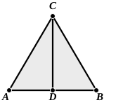

The property of the curve is that, if $F$ is any point, the arc $BED$ is to the arc $ED$ as $AB$ is to $FH$.

In other words, if $\phi$ is the angle $FAD$, $\rho$ the radius vector $AF$ and $a$ the side of the square,

$$(\rho \sin \phi)/a = \phi/\frac{1}{2}\pi.$$

Now the angle $EAD$ can not only be *trisected* but *divided in any given ratio* by means of the quadratrix (Pappus iv. p. 286).

For let $FH$ be divided at $K$ in the given ratio.

Draw $KL$ parallel to $AD$, meeting the curve in $L$; join $AL$ and produce it to meet the circle in $N$.

Then the angles $EAN$, $NAD$ are in the ratio of $FK$ to $KH$, as is easily proved.

#### (c) Use of the *spiral of Archimedes*.

The trisection of an angle, or the division of an angle in any ratio, by means of the *spiral of Archimedes* is of course an equally simple matter.  Suppose any angle included between the two radii vectores $OA$ and $OB$ of the spiral, and let it be required to cut the angle $AOB$ in a given ratio.  Since the radius vector increases proportionally with the angle described by the vector which generates the curve (reckoned from the original position of the vector coinciding with the initial line to the particular position assumed), we have only to take the radius vector $OB$ (the greater of the two $OA$, $OB$), mark off $OC$ along it equal to $OA$, cut $CB$ in the given ratio (at $D$ say), and then draw the circle with centre $O$ and radius $OD$ cutting the spiral in $E$.  Then $OE$ will divide the angle $AOB$ in the required manner.

### PROPOSITION 10.

#### *To bisect a given finite straight line.*

Let $AB$ be the given finite straight line.  
Thus it is required to bisect the finite straight line $AB$.

Let the equilateral triangle $ABC$ be constructed on it, [I. 1]  
and let the angle $ACB$ be bisected by the straight line $CD$; [I. 9]

I say that the straight line $AB$ has been bisected at the point $D$.

For, since $AC$ is equal to $CB$, and $CD$ is common,  
the two sides $AC$, $CD$ are equal to the two sides $BC$, $CD$ respectively;  
and the angle $ACD$ is equal to the angle $BCD$;  
therefore the base $AD$ is equal to the base $BD$. [I. 4]

Therefore the given finite straight line $AB$ has been bisected at $D$.

Q. E. F.
