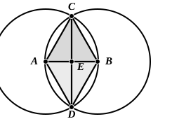

Apollonius, we are told (Proclus, pp. 279, 16—280, 4), bisected a straight line $AB$ by a construction like that of I. 1.  With centres $A$, $B$, and radii $AB$, $BA$ respectively, two circles are described, intersecting in $C$, $D$.  Joining $CD$, $AC$, $CB$, $AD$, $DB$, Apollonius proves in two steps that $CD$ bisects $AB$.

(1) Since, in the triangles $ACD$, $BCD$,  
two sides $AC$, $CD$ are equal to two sides $BC$, $CD$,  
and the bases $AD$, $BD$ are equal,  
the angle $ACD$ is equal to the angle $BCD$. [I. 8]

(2) The latter angles being equal, and $AC$ being equal to $CB$, while $CE$ is common,  
the equality of $AE$, $EB$ follows by I. 4.

The objection to this proof is that, instead of assuming the bisection of the angle $ACB$, as already effected by I. 9, Apollonius goes a step further back and embodies a construction for bisecting the angle.  That is, he unnecessarily does over again what has been done before, which is open to objection from a theoretical point of view.

Proclus (pp. 277, 25—279, 4) warns us against being moved by this proposition to conclude that geometers assumed, as a preliminary hypothesis, that a line is not made up of indivisible parts (ἐξ ἀμερῶν).  This might be argued thus.  If a line is made up of indivisibles, there must be in a finite line either an odd or an even number of them.  If the number were odd, it would be necessary in order to bisect the line to bisect an indivisible (the odd one).  In that case therefore it would not be possible to bisect a straight line, if it is a magnitude made up of indivisibles.  But, if it is not so made up, the straight line can be divided *ad infinitum* or without limit (ἐπ᾽ ἄπειρον διαιρεῖται).  Hence it was argued (φασίν), says Proclus, that the divisibility of magnitudes without limit was admitted and assumed as a geometrical principle.  To this he replies, following Geminus, that geometers did indeed assume, by way of a common notion, that a continuous magnitude, i.e. a magnitude consisting of parts connected together (συνημμένων), is divisible (διαιρετόν).  But *infinite* divisibility was not assumed by them; it was *proved* by means of the first principles applicable to the case.  “For when,” he says, “they prove that the incommensurable exists among magnitudes, and that it is not all things that are commensurable with one another, what else will any one say that they prove but that every magnitude can be divided for ever, and that we shall never arrive at the indivisible, that is, the least common measure of the magnitudes?  This then is matter of demonstration, whereas it is an *axiom* that everything continuous is divisible, so that a finite continuous line is divisible.  The writer of the Elements bisects a finite straight line, starting from the latter notion, and not from any assumption that it is divisible without limit.”  Proclus adds that the proposition may also serve to refute Xenocrates’ theory of indivisible lines (ἄτομοι γραμμαί).  The argument given by Proclus to disprove the existence of indivisible lines is substantially that used by Aristotle as regards magnitudes generally (cf. *Physics* VI. 1, 231 a 21 sqq. and especially VI. 2, 233 b 15—32).
