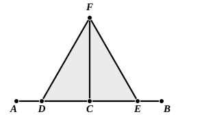

### PROPOSITION 11.

To draw a straight line at right angles to a given straight line from a given point on it.

Let $AB$ be the given straight line, and $C$ the given point on it.

5 Thus it is required to draw from the point $C$ a straight line at right angles to the straight line $AB$.

Let a point $D$ be taken at random on $AC$;  
10 let $CE$ be made equal to $CD$; [I. 3]  
on $DE$ let the equilateral triangle ">$FDE$ be constructed, [I. 1]  
and let $FC$ be joined;

I say that the straight line $FC$ has been drawn at right  
15 angles to the given straight line $AB$ from $C$ the given point on it.

For, since $DC$ is equal to $CE$,  
and $CF$ is common,  

20 the two sides $DC$, $CF$ are equal to the two sides $EC$, $CF$ respectively;

and the base $DF$ is equal to the base $FE$;  

therefore the angle $DCF$ is equal to the angle $ECF$; [I. 8]

and they are adjacent angles.

But, when a straight line set up on a straight line makes  
25 the adjacent angles equal to one another, each of the equal angles is right; [Def. 10]  

therefore each of the angles $DCF$, $FCE$ is right.

Therefore the straight line $CF$ has been drawn at right angles to the given straight line $AB$ from the given point  
30 $C$ on it.

Q. E. F.

---

**10. let $CE$ be made equal to $CD$.** The verb is κείσθω which, as well as the other parts of κεῖμαι, is constantly used for the passive of τίθημι “to place”; and the latter word is constantly used in the sense of *making*, e.g., one straight line equal to another straight line.

De Morgan remarks that this proposition, which is “to bisect the angle made by a straight line and its continuation” [i.e. a *flat angle*], should be a particular case of I. 9, the constructions being the same. This is certainly
