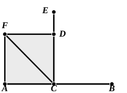

worth noting, though I doubt the advantage of rearranging the propositions in consequence.

Apollonius gave a construction for this proposition (see Proclus, p. 282, 8) differing from Euclid’s in much the same way as his construction for bisecting a straight line differed from that of I. 10. Instead of assuming an equilateral triangle drawn without repeating the process of I. 1, Apollonius takes $D$ and $E$ equidistant from $C$ as in Euclid, and then draws circles in the manner of I. 1 meeting at $F$.

This necessitates proving again that $DF$ is equal to $FE$; whereas Euclid’s assumption of the construction of I. 1 in the words “let the equilateral triangle ">$FDE$ be constructed” enables him to dispense with the drawing of circles and with the proof that $DF$ is equal to $FE$ at the same time. While however the substitution of Apollonius’ constructions for I. 10 and 11 would show faulty arrangement in a theoretical treatise like Euclid’s, they are entirely suitable for what we call *practical geometry*, and such may have been Apollonius’ object in these constructions and in his alternative for I. 23.

Proclus gives a construction for drawing a straight line at right angles to another straight line but from *one end* of it, instead of from an intermediate point on it, it being supposed (for the sake of argument) that we are not permitted to *produce* the straight line. In the commentary of an-Nairīzī (ed. Besthorn-Heiberg, pp. 73—4; ed. Curtze, pp. 54—5) this construction is attributed to Heron.

Let it be required to draw from $A$ a straight line at right angles to $AB$.  
On $AB$ take any point $C$, and in the manner of the proposition draw $CE$ at right angles to $AB$.  
From $CE$ cut off $CD$ equal to $AC$, bisect the angle $ACE$ by the straight line $CF$, [I. 9] and draw $DF$ at right angles to $CE$ meeting $CF$ in $F$. Join $FA$.

Then the angle $FAC$ will be a right angle.

For, since, in the triangles ">$ACF$, ">$DCF$, the two sides $AC$, $CF$ are equal to the two sides $DC$, $CF$ respectively, and the included angles $ACF$, $DCF$ are equal,  
the triangles are equal in all respects. [I. 4]

Therefore the angle at $A$ is equal to the angle at $D$, and is accordingly a right angle.

### PROPOSITION 12.

To a given infinite straight line, from a given point which is not on it, to draw a perpendicular straight line.

Let $AB$ be the given infinite straight line, and $C$ the given point which is not on it;
