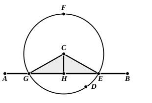

5 thus it is required to draw to the given infinite straight line $AB$, from the given point $C$ which is not on it, a perpendicular straight line.

For let a point $D$ be taken  
10 at random on the other side of the straight line $AB$, and with centre $C$ and distance $CD$ let the circle $EFG$ be described; [Post. 3]  
let the straight line $EG$  
15 be bisected at $H$, [I. 10]  
and let the straight lines $CG$, $CH$, $CE$ be joined. [Post. 1]

I say that $CH$ has been drawn perpendicular to the given infinite straight line $AB$ from the given point $C$ which is not on it.

20 For, since $GH$ is equal to $HE$,  
and $HC$ is common,  

the two sides $GH$, $HC$ are equal to the two sides $EH$, $HC$ respectively;

and the base $CG$ is equal to the base $CE$;  

25 therefore the angle $CHG$ is equal to the angle $EHC$. [I. 8]

And they are adjacent angles.

But, when a straight line set up on a straight line makes the adjacent angles equal to one another, each of the equal angles is right, and the straight line standing on the other is  
30 called a perpendicular to that on which it stands. [Def. 10]

Therefore $CH$ has been drawn perpendicular to the given infinite straight line $AB$ from the given point $C$ which is not on it.

Q. E. F.

---

**2. a perpendicular straight line**, κάθετον εὐθεῖαν γραμμήν. This is the full expression for a perpendicular, κάθετος meaning *let fall* or *let down*, so that the expression corresponds to our *plumb-line*. ἡ κάθετος is however constantly used alone for a perpendicular, γραμμή being understood.

**10. on the other side of the straight line $AB$**, literally “towards the other parts of the straight line $AB$,” ἐπὶ τὰ ἕτερα μέρη τῆς $AB$. Cf. “on the same side” (ἐπὶ τὰ αὐτὰ μέρη) in Post. 5 and “in both directions” (ἐφ᾽ ἑκάτερα τὰ μέρη) in Def. 23.

“This problem,” says Proclus (p. 283, 7—10), “was first investigated by Oenopides [5th cent. B.C.], who thought it useful for astronomy. He however calls the perpendicular, in the archaic manner, (a line drawn)
