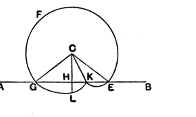

gnomon-wise (κατὰ γνώμονα), because the *gnomon* is also at right angles to the horizon.” In this earlier sense the *gnomon* was a staff placed in a vertical position for the purpose of casting shadows and so serving as a means of measuring time (Cantor, *Geschichte der Mathematik*, I₃, p. 161). The later meanings of the word as used in Eucl. Book II. and elsewhere will be explained in the note on Book II. Def. 2.

Proclus says that two kinds of perpendicular were distinguished, the “plane” (ἐπίπεδος) and the “solid” (στερεά), the former being the perpendicular dropped on a line in a plane and the latter the perpendicular dropped on a plane. The term “solid perpendicular” is sufficiently curious, but it may perhaps be compared with the Greek term “solid locus” applied to a conic section, apparently on the ground that it has its origin in the section of a solid, namely a cone.

Attention is called by most editors to the assumption in this proposition that, if only $D$ be taken on the side of $AB$ remote from $C$, the circle described with $CD$ as radius must necessarily cut $AB$ in two points. To satisfy us of this we need, as in I. 1, some postulate of continuity, e.g. something like that suggested by Killing (see note on the Principle of Continuity above, p. 235):
“If a point [here the point describing the circle] moves in a figure which is divided into two parts [by the straight line], and if it belongs at the beginning of the motion to one part and at another stage of the motion to the other part, it must during the motion cut the boundary between the two parts,” and this of course applies to the motion in *two* directions from $D$.

But the editors have not, as a rule, noticed a possible objection to the Euclidean statement of this problem which is much more difficult to dispose of at this stage, i.e. without employing any proposition later than this in Euclid’s order. How do we know, says the supposed critic, that the circle does not cut $AB$ in *three* or more points, in which case there would be not one perpendicular but *three* or more? Proclus (pp. 286, 12—289, 6) tries to refute this objection, and it is interesting to follow his argument, though it will easily be seen to be inconclusive. He takes in order three possible suppositions.

1. May not the circle meet $AB$ in a third point $K$ between the middle point of $GE$ and either extremity of it, taking the form drawn in the figure appended?

Suppose this possible. Bisect $GE$ in $H$. Join $CH$, and produce it to meet the circle in $L$. Join $CG$, $CK$, $CE$.

Then, since $CG$ is equal to $CE$, and $CH$ is common, while the base $GH$ is equal to the base $HE$,  
the angles $CHG$, $CHE$ are equal and, since they are adjacent, they are both right.

Again, since $CG$ is equal to $CE$,  
the angles at $G$ and $E$ are equal.

Lastly, since $CK$ is equal to $CG$ and also to $CE$, the angles $CGK$, $CKG$ are equal, as also are the angles $CKE$, $CEK$.

Since the angles $CGK$, $CEK$ are equal, it follows that  
the angles $CKG$, $CKE$ are equal and therefore both right.

Therefore the angle $CKH$ is equal to the angle $CHK$,  
and $CH$ is equal to $CK$.
