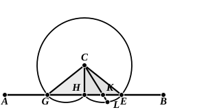

But $CK$ is equal to $CL$, by the definition of the circle; therefore $CH$ is equal to $CL$: which is impossible.

Thus Proclus; but why should not the circle meet $AB$ in $H$ as well as $K$?

2. May not the circle meet $AB$ in $H$ the middle point of $GE$ and take the form shown in the second figure?

In that case, says Proclus, join $CG$, $CH$, $CE$ as before. Then bisect $HE$ at $K$, join $CK$ and produce it to meet the circumference at $L$.

Now, since $HK$ is equal to $KE$, $CK$ is common, and the base $CH$ is equal to the base $CE$,  
the angles at $K$ are equal and therefore both right angles.

Therefore the angle $CHK$ is equal to the angle $CKH$, whence $CK$ is equal to $CH$ and therefore to $CL$: which is impossible.

So Proclus; but why should not the circle meet $AB$ in $K$ as well as $H$?

3. May not the circle meet $AB$ in two points besides $G$, $E$ and pass, between those two points, to the side of $AB$ towards $C$, as in the next figure?

Here again, by the same method, Proclus proves that, $K$, $L$ being the other two points in which the circle cuts $AB$,  
$CK$ is equal to $CH$,  
and, since the circle cuts $CH$ in $M$,  
$CM$ is equal to $CK$ and therefore to $CH$: which is impossible.

But, again, why should the circle not cut $AB$ in the point $H$ as well?

In fact, Proclus’ cases are not mutually exclusive, and his method of proof only enables us to show that, if the circle meets $AB$ in one more point besides $G$, $E$, it must meet it in more points still. We can always find a new point of intersection by bisecting the distance separating any two points of intersection, and so, applying the method *ad infinitum*, we should have to conclude ultimately that the circle with radius $CH$ (or $CG$) coincides with $AB$. It would follow that a circle with centre $C$ and radius greater than $CH$ would not meet $AB$ at all. Also, since all straight lines from $C$ to points on $AB$ would be equal in length, there would be an infinite number of perpendiculars from $C$ on $AB$.

Is this under any circumstances possible? It is not possible in Euclidean space, but it is possible, under the Riemann hypothesis (where a straight line is a “closed series” and returns on itself), in the case where $C$ is the pole of the straight line $AB$.

It is natural therefore that, for a proof that in Euclidean space there is only one perpendicular from a point to a straight line, we have to wait until I. 16, the precise proposition which under the Riemann hypothesis is only valid with a certain restriction and not universally. There is no difficulty involved by waiting until I. 16, since I. 12 is not used before that proposition is reached; and we are only in the same position as when, in order to satisfy ourselves of the number of possible solutions of I. 1, we have to wait till I. 7.

But if we wish, after all, to prove the truth of the assumption *without recourse to any later proposition than* I. 12, we can do so by means of this same invaluable I. 7.
