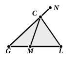

If the circle intersects $AB$ as before in $G$, $E$, let $H$ be the middle point of $GE$, and suppose, if possible, that the circle also intersects $AB$ in any other point $K$ on $AH$.

From $H$, on the side of $AB$ opposite to $C$, draw $HL$ at right angles to $AB$, and make $HL$ equal to $HC$.  
Join $CG$, $LG$, $CK$, $LK$.

Now, in the triangles ">$CHG$, ">$LHG$,  
$CH$ is equal to $LH$, and $HG$ is common.  
Also the angles $CHG$, $LHG$, being both right, are equal.  
Therefore the base $CG$ is equal to the base $LG$.  
Similarly we prove that $CK$ is equal to $LK$.  
But, by hypothesis, since $K$ is on the circle,  
$CK$ is equal to $CG$.  
Therefore $CG$, $CK$, $LG$, $LK$ are all equal.

Now the next proposition, I. 13, will tell us that $CH$, $HL$ are in a straight line; but we will not assume this. Join $CL$.  
Then on the same base $CL$ and on the same side of it we have two pairs of straight lines drawn from $C$, $L$ to $G$ and $K$ such that $CG$ is equal to $CK$ and $LG$ to $LK$.  
But this is impossible [I. 7].  
Therefore the circle cannot cut $BA$ or $BA$ produced in any point other than $G$ on that side of $CL$ on which $G$ is.  
Similarly it cannot cut $AB$ or $AB$ produced at any point other than $E$ on the other side of $CL$.

The only possibility left therefore is that the circle might cut $AB$ in the same point as that in which $CL$ cuts it. But this is shown to be impossible by an adaptation of the proof of I. 7.

For the assumption is that there may be some point $M$ on $CL$ such that $CM$ is equal to $CG$ and $LM$ to $LG$.  
If possible, let this be the case, and produce $CG$ to $N$.

Then, since $CM$ is equal to $CG$,  
the angle $NGM$ is equal to the angle $GML$ [I. 5, part 2].  
Therefore the angle $GML$ is greater than the angle $MGL$.  
Again, since $LG$ is equal to $LM$,  
the angle $GML$ is equal to the angle $MGL$.  
But it was also greater: which is impossible.  
Hence the circle in the original figure cannot cut $AB$ in the point in which $CL$ cuts it.  
Therefore the circle cannot cut $AB$ in any point whatever except $G$ and $E$.

[This proof of course does not prove that $CK$ is less than $CG$, but only that it is not equal to it. The proposition that, of the obliques drawn from $C$ to $AB$, that is less the foot of which is nearer to $H$ can only be proved later. The proof by I. 7 also fails, under the Riemann hypothesis, if $C$, $L$ are the poles of the straight line $AB$, since the broken lines $CGL$, $CKL$ etc. become equal straight lines, all perpendicular to $AB$.]

Proclus rightly adds (p. 289, 18 sqq.) that it is not necessary to take $D$ on the side of $AB$ away from $C$ if an objector “says that there is no space on
